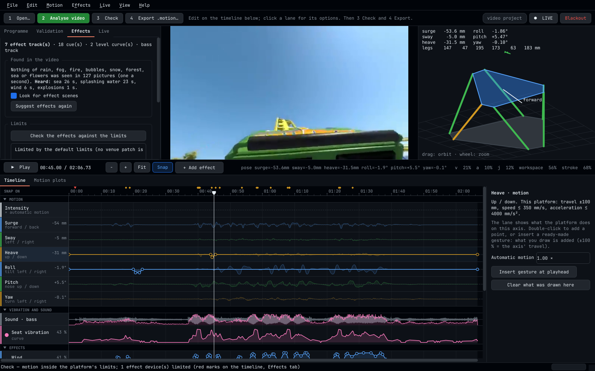

# Extended 4D Editor 3.2.0

One program — and one AppImage that works without a network — for everything between a programme
video and a moving, blowing, raining, rumbling theatre seat:

* **Editor** (desktop application): open a video and press **Analyse video**. The motion of the
  platform on its six axes, the vibration and bass for shakers and subwoofers, and a draft of the
  effects (wind, rain, fog, heat for fire, bubbles, snow, water spray, scent, air blasts, strobe)
  are worked out from the picture and the sound. Everything is then edited on **one timeline**,
  checked against the limits, tried live on the real devices, and exported as **one `.motion`
  file**.
* **Show service** (`fourdvr controller run`): the process that plays that file at show time. It
  drives the Stewart platforms and, in step with them, the DMX devices and the bass shakers —
  from the PC's own outputs (sACN, Art-Net, USB DMX, sound card) or **through the ESP32 boards**
  (a DMX line and an audio output on each). Hardware that is not there is left out without an
  error; everything else keeps running.
* **Live mode** (`fourdvr live run`, new in 3.1): no file at all. The telemetry of a running game
  or flight simulator, a captured screen or stream, or just the sound drives the same platforms,
  effects and shakers as it happens — through the same limits. A live session can be recorded and
  made into a programme — together with a video of the session, one the Control Server accepts —
  which is how an experience that is not a video becomes 4D ([docs/LIVE.md](docs/LIVE.md)).
* **Streaming** (`fourdvr stream serve`, new in 3.1): the same computer offers videos — flat, 180°,
  360°, mono or stereo — to any device on the network: a page for browsers on phones, tablets,
  computers, televisions and headsets, and an address for any player. Everybody who has the page
  open sees the same moment of the video, started by an operator or **in step with the theatre's
  show** ([docs/STREAMING.md](docs/STREAMING.md)).
* **Venue** (*Live ▸ Venue…*, `fourdvr fx fixtures`, `fourdvr fx ready`, new in 3.2): the venue's
  patch is made in a window instead of a text editor; real devices come from a **fixture library**
  (653 devices of the Open Fixture Library, inside the package); the devices and the 512 DMX
  channels are shown **with the film, simulated, without hardware**; and one report answers
  **"is the venue ready?"** - ESP32 boards, delays, lost packets, signal loss, the Control
  Server's headsets and platform controllers ([docs/VENUE.md](docs/VENUE.md)).
* **Tools** (`fourdvr extract …`, `fourdvr fx …`): the same work on the command line, and the
  commissioning tools for a venue's devices.

This is version 3 of what was called *4D VR Theatre Studio 2.0* (and before that *Motion
Extractor* and *Motion Controller*). Files, projects, configurations and commands of versions 2
and 3.0 keep working; the Control Server and the VR Player are unchanged and need no update
([docs/MIGRATION.md](docs/MIGRATION.md)).



```
                 workstation                                            theatre
┌────────────────────────────────────────────────┐   ┌────────────────────────────────────────────────┐
│ Extended 4D Editor                             │   │ Control Server (unchanged)                     │
│ video ─► camera motion ─► platform motion      │   │   validates, stores, distributes .motion       │
│       ─► sound ─► bass track, seat vibration   │   │   PLAY / PAUSE / RESUME / STOP on one clock    │
│       ─► scenes in picture and sound           │   └───────────────┬────────────────────────────────┘
│            ─► rain · fog · heat · bubbles ·    │                   │ 4D-VR-THEATRE/1
│               snow · water · scent             │   ┌───────────────▼────────────────────────────────┐
│ ONE timeline:  MOTION                          │   │ Show service (fourdvr controller run) on a PC  │
│                VIBRATION AND SOUND             │   │  motion ─► limits ─► kinematics ─► ESP32 ─► 6 actuators
│                EFFECTS                         │   │  effects ─► venue patch ─► limits ─► either    │
│ limits: platform profile · venue or default    │   │     the PC: sACN / Art-Net / USB DMX, sound card
│ LIVE: the show's own engine on the real devices│   │     or the ESP32s: DMX line + audio output each│
│                  └─► programme.motion ─────────┼──►│  a device or board that is missing: left out   │
└────────────────────────────────────────────────┘   └────────────────────────────────────────────────┘
```

## What the analysis finds, and from what

| Part of the programme | Found from | On the timeline | At the venue |
|---|---|---|---|
| Motion, six axes (surge, sway, heave, roll, pitch, yaw) | camera motion in the picture (optical flow, classical computer vision) | group **Motion**: intensity lane and one lane per axis | Stewart platform, inside the limits of its profile |
| Bass track | the video's sound, low-pass filtered | lane **Sound · bass** | subwoofers / bass shakers |
| Seat vibration | camera shake and bass energy | level curve | bass shakers (a synthesised rumble) |
| Wind | forward speed of the camera | level curve | fans |
| Air blast | impacts in the motion | short cues | air valves |
| Strobe / lightning | sudden flashes of the picture | cues with a flash rate | strobe, LED flash (rate capped by the venue, 3 per second by default) |
| Rain | scenes: rain seen, the more if also heard | cues as long as it rains | overhead rain nozzles |
| Fog / smoke | scenes: fog, mist or smoke seen | a burst when the scene starts, repeated in long scenes | fog or haze machine |
| Heat | scenes: fire seen | cues as long as the fire | warm air or a heat lamp (never open flame) |
| Bubbles | scenes: bubbles or underwater seen | cues | bubble machine |
| Snow | scenes: falling snow or a snow landscape seen | cues | snow machine |
| Water spray | scenes: splashing water seen (and heard, if there is sound) | short bursts | mist nozzles |
| Scent | scenes: forest, sea or flowers seen | one burst a scene, cartridge 1 / 2 / 3 | scent dispenser |
| DMX channel, any other name | — (added by hand) | level curve or cues | lighting, anything the venue patches under that name |

Scenes are recognised on the workstation by two neural-network models that are inside the AppImage
(a picture model and a sound model, 203 MB together); nothing is sent anywhere and no network is
needed. What they suggest is a **draft**: on 1 052 sample pictures the picture model found most
rain, fog, fire, snow and underwater scenes and raised one false alarm, but it has not been
measured on films, so look at every lane before a programme goes to an audience
([docs/SCENE_DETECTION.md](docs/SCENE_DETECTION.md)). Whatever a file asks for, the venue's limits
decide how long and how often a device runs.

## Nothing depends on anything else

* A programme without effects is a plain `.motion` file. It plays on a venue with or without
  effect devices.
* A programme *with* effects plays on a venue *without* effect devices as motion only; on a venue
  with some of them, effect types that have no device there are skipped.
* A venue without an `[effects]` section in its controller configuration plays motion only. Tests
  check that the platform poses are bit-identical with and without effects.
* With effects through ESP32 boards, the show service asks every board each second what it has.
  A board that does not answer, has no DMX line or no audio output is left out — no error, no
  delay; a board that is switched on later is found within three seconds.
* The effects run in their own thread. A wrong patch, an unreachable DMX node or board, a missing
  sound card or a damaged effects section is reported in the status and never stops or delays
  motion.

## One file

The programme is one `.motion` file: a JSON header (programme, platform limits used, validation
result, and the optional `effects` section with every effect track) followed by a binary block
(the motion samples; the bass track is inside the header's effects section, compressed). The
Control Server stores and distributes it like any motion file. The show service on the PC plays
it and sends each ESP32 board what it needs at that moment: platform positions on the motion link,
DMX levels and bass sound on the effects link. The boards store no programme and need no update
when a programme changes ([docs/ESP32_EFFECTS_LINK.md](docs/ESP32_EFFECTS_LINK.md)).

## Four ways to run the same program

| You want to | Run | Details |
|---|---|---|
| make or edit a programme | `fourdvr` (or double-click the AppImage) | [docs/USER_GUIDE.md](docs/USER_GUIDE.md) |
| run the show PC | `fourdvr controller run -c controller.toml` | [INSTALL.md](INSTALL.md), [docs/EFFECTS_GUIDE.md](docs/EFFECTS_GUIDE.md) |
| drive the theatre from a game, a live picture or sound | `fourdvr live run -c live.toml` | [docs/LIVE.md](docs/LIVE.md) |
| show a video on any device of the network, on one clock | `fourdvr stream serve FOLDER` | [docs/STREAMING.md](docs/STREAMING.md) |
| work in a terminal / scripts | `fourdvr extract …`, `fourdvr fx …`, `fourdvr controller …`, `fourdvr live …`, `fourdvr stream …` | [docs/CLI.md](docs/CLI.md) |

`fourdvr-extract` and `fourdvr-motion` still exist and do what they did.

## Quick start

```bash
# AppImage (Linux x86_64, nothing to install, no network needed)
chmod +x Extended-4D-Editor-3.2.0-x86_64.AppImage
./Extended-4D-Editor-3.2.0-x86_64.AppImage                        # the Editor
./Extended-4D-Editor-3.2.0-x86_64.AppImage --help                 # the command line

# the same on the command line: motion, bass and drafted effects in one file
./Extended-4D-Editor-3.2.0-x86_64.AppImage extract generate ride.mp4 --projection 360 \
    --effects suggest --bass -o ride.motion
./Extended-4D-Editor-3.2.0-x86_64.AppImage fx info ride.motion

# live mode, without a game and without hardware: a made-up drive in a window
./Extended-4D-Editor-3.2.0-x86_64.AppImage live run --source demo --window

# a video for every device on the network: it prints the address to open in their browsers
./Extended-4D-Editor-3.2.0-x86_64.AppImage stream serve ride.mp4
```

In the Editor: **1 Open…** a video → **2 Analyse video** → edit on the timeline (click a lane for
its options, double-click it to add a cue or a curve point, **+ Add effect** for a new lane) →
**3 Check** → **4 Export .motion…**. To try the effects on the devices: **Live ▸ Load venue
patch… → ● LIVE → Play**.

From this source package (Python 3.12 or newer): see [INSTALL.md](INSTALL.md).

## Documentation

| File | Content |
|---|---|
| [INSTALL.md](INSTALL.md) | workstation and show-PC installation, service, firmware, updating |
| [docs/USER_GUIDE.md](docs/USER_GUIDE.md) | the Editor step by step: analysis, the three groups of lanes, live testing, export |
| [docs/LIVE.md](docs/LIVE.md) | live mode: sources, checking the directions, the delay of a captured picture, safety, recording a session and making a programme of it |
| [docs/TELEMETRY_FORMATS.md](docs/TELEMETRY_FORMATS.md), [docs/LIVE_FORMAT.md](docs/LIVE_FORMAT.md) | what is read from each game's telemetry and how certain each direction is; the open format for your own experience |
| [docs/STREAMING.md](docs/STREAMING.md) | streaming: what a network carries, which videos browsers play, the one clock, in step with the theatre's show, https and VR in a headset's browser |
| [docs/SCENE_DETECTION.md](docs/SCENE_DETECTION.md) | how rain, fog, fire, bubbles, snow and scent scenes are found; what was measured; the models |
| [docs/EFFECTS_GUIDE.md](docs/EFFECTS_GUIDE.md) | the venue side: patch file, outputs (network DMX, USB, ESP32, sound), limits, commissioning, safety |
| [docs/VENUE.md](docs/VENUE.md) | the venue window (patch, devices and DMX with the film), the fixture library, "is the venue ready?" |
| [docs/ESP32_EFFECTS_LINK.md](docs/ESP32_EFFECTS_LINK.md) | DMX and bass through ESP32 boards: wiring, firmware variants, the link's packets |
| [docs/EFFECTS_FORMAT.md](docs/EFFECTS_FORMAT.md) | the effects document (inside `.motion`, or `.fx.json`) |
| [docs/CLI.md](docs/CLI.md) | every command |
| [docs/APPIMAGE.md](docs/APPIMAGE.md) | building, running and licensing of the single-file AppImage |
| [docs/MIGRATION.md](docs/MIGRATION.md) | coming from 4D VR Theatre Studio 2.0, Motion Extractor 1.1 or Motion Controller 1.0 |
| [docs/TROUBLESHOOTING.md](docs/TROUBLESHOOTING.md) | problems and fixes |
| [docs/MOTION_ALGORITHM.md](docs/MOTION_ALGORITHM.md), [docs/PLATFORM_PROFILES.md](docs/PLATFORM_PROFILES.md) | how motion is estimated, cued and constrained; platform profiles |
| [docs/MOTION_FORMAT.md](docs/MOTION_FORMAT.md) | the `.motion` file format 1.0 (with the optional `effects` section) |
| [docs/PLATFORM_CONFIGURATION.md](docs/PLATFORM_CONFIGURATION.md), [docs/STEWART_KINEMATICS.md](docs/STEWART_KINEMATICS.md), [docs/CALIBRATION.md](docs/CALIBRATION.md) | show service: configuration, kinematics, commissioning of the platforms |
| [docs/ESP32_PROTOCOL.md](docs/ESP32_PROTOCOL.md), [docs/PROTOCOL.md](docs/PROTOCOL.md) | actuator-bridge link and server protocol |
| [integration/README.md](integration/README.md) | end-to-end tests on one PC: real sACN, simulated ESP32 boards running the firmware's own code, the live mode with a simulated game, and streaming with real browsers |
| [THIRD_PARTY_LICENSES.md](THIRD_PARTY_LICENSES.md) | libraries, the bundled font and the two models |

## Package contents

| Path | Content |
|---|---|
| `src/fourdvr_studio/` | the `fourdvr` command, projects, live output, desktop application (`gui/`) |
| `src/fourdvr_extractor/` | video analysis, motion cueing and constraints, manual motion, sound track, scene detection, effect suggestions |
| `src/fourdvr_fx/` | effects: document format, venue patch, limits, engine, outputs (sACN, Art-Net, USB DMX, ESP32 link, sound), tools |
| `src/fourdvr_motion/` | show service: timeline, limits, kinematics, ESP32 motion link, server protocol |
| `src/fourdvr_live/` | live mode: sources (telemetry formats, picture, sound), real-time cueing, safety, live effects and shaker sound, sessions, the live window, a simulator of every format |
| `src/fourdvr_stream/` | streaming: the video list, the HTTP server with its one clock, the viewer's and the operator's page (`web/`), following the Control Server, tools (check, prepare, test video, simulated viewers) |
| `config/` | example controller configuration, platform profiles, example venue patches (network DMX, ESP32), example live configurations |
| `firmware/esp32-actuator-bridge/` | ESP32 firmware: actuator bridge, DMX output, audio output (any combination), with host tests and a PC simulator |
| `packaging/models/` | build script for the scene models (pinned downloads with checksums) |
| `packaging/appimage/` | build script of the AppImage |
| `deploy/systemd/` | service units for the show PC: the show service, the stream server |
| `integration/` | end-to-end test scripts |
| `tests/` | 350 automated tests (pytest), including the desktop application off-screen |

## What was tested, and what was not

Tested here (see `integration/` and `tests/`):

* the complete chain from an Editor export through the unchanged Control Server 1.0.0 to the show
  service and **real sACN packets** on a network interface, compared frame by frame with the
  programme (every fixture within 50 ms, pause, resume, stop, a motion-only programme);
* the same chain with effects **through ESP32 boards**, where each board is the firmware's own
  portable code running behind a real UDP socket on the PC: DMX on two boards equal to the
  programme, the bass in step with the show (sample-exact against the programme, played 25 ms
  early for the output stage as designed), emergency stop at a board, a board unplugged and
  plugged in again, a platform whose board never answers;
* scene detection: the picture model against a reference implementation and on 1 052 sample
  pictures, the sound model against its reference implementation; the complete analysis on a
  360° ride video and on a test film cut from still pictures;
* the desktop application off-screen, including the one-step analysis, every lane's options and
  the Live tab with a simulated board;
* live mode: every telemetry decoder against packets built from the published layouts; a simulated
  game (F1 25 packets over real UDP) driving two simulated boards and real sACN, with the game
  closed and coming back; a rendered camera rotation and a ride video through the picture path;
  the live window on an X server (Xvfb) grabbing a panning picture from the screen while the show
  runs in its own process; recording, the programme made of the session, a video of the session
  found in it by its picture, and that programme accepted and published by the Control Server
  ([docs/LIVE.md](docs/LIVE.md) §13);
* streaming: a server process with fifty simulated viewers at once; four browsers (headless
  Chromium) that start together and stay within a frame of the server's timeline, through pause,
  jumps, a looped 360° video and a late viewer; a second stream server following the show of the
  real Control Server, its browsers at the theatre's position ([docs/STREAMING.md](docs/STREAMING.md) §8).

**Not tested: any physical device — and any real game.**

* Live mode was **not run against a real game, console, simulator, capture card, sound input or
  real desktop**: none exists in the test environment. Most games do not publish which way a positive value
  points, so the directions are checked once per game with `fourdvr live monitor`
  ([docs/LIVE.md](docs/LIVE.md) §4) — with nobody on the platform.
* Streaming was **not tried on a real phone, tablet, television or headset, in no browser but
  Chromium, and on no real network**: VR mode in a headset's browser and looking around by turning
  a phone are untested on devices, and whether a venue's Wi-Fi carries its viewers is measured
  there, with `fourdvr stream probe` ([docs/STREAMING.md](docs/STREAMING.md) §2, §8).

* The ESP32 firmware was **never compiled for an ESP32 and never run on a board** in this
  environment (the tool chain could not be used here). Its logic is tested on a PC, and the
  board-specific part is checked against the function declarations of ESP-IDF 4.4.7 and 5.1.4,
  but pins, timing of the DMX signal and the audio output must be proven on your hardware:
  docs/ESP32_EFFECTS_LINK.md has the first-power-on checklist.
* **No device was driven with an entry from the fixture library.** That a device does what its
  library file says is the file's claim; the venue check was run against simulated boards and
  the firmware's code on a PC, not against a board, an Art-Net node or a theatre's network
  ([docs/VENUE.md](docs/VENUE.md) §5).
* No DMX device, fog or snow machine, valve, heater, strobe, scent unit, RS-485 driver, audio
  converter, amplifier or bass shaker was connected. The USB DMX output (Enttec DMX USB Pro
  compatible) is implemented from the published protocol and verified at byte level only.
* Scene detection was not measured on a set of real films with known content. Treat its
  suggestions as a first draft.

Commission every device with `fourdvr fx fire` / the Editor's Live tab as described in
docs/EFFECTS_GUIDE.md before it is used with an audience.

## SAFETY — read before connecting anything

This software generates motion commands and effect triggers. **It is not a safety system and is
not certified for human safety.**

**Motion.** A passed validation means "inside the configured software limits", not "safe for
passengers". The show service enforces each platform's limits again at run time, whatever a file
contains. Structural design, actuator ratings, mechanical end stops, electrical protection, a
hardwired fail-safe emergency stop that removes actuator power independently of this software,
safe behaviour on actuator or power failure, passenger restraint, load testing, commissioning and
validation by qualified engineers against the rules that apply where the theatre operates are the
responsibility of the platform's builder and operator, and outside the scope of this software.
Never ride a platform during commissioning; test with ballast first.

**Effects.** DMX, the ESP32 effects link and audio are entertainment controls, **not safety
functions**. The limits (longest time on, pause after it, share of time, total per show, flash
rate) are numerical safeguards against programming and software errors; they do not make a device
safe. The default numbers are cautious starting values chosen for this software, not figures taken
from a standard: each venue sets its own in its patch after its own risk assessment.

* Power to water, rain, fog, snow, bubble, heat, scent, strobe and air devices that must stop in
  an emergency has to be switched by the emergency-stop circuit, not by DMX. A DMX device that
  loses its signal must switch itself off (set its "hold last value" option to off). An ESP32
  board stops its DMX line and its sound when its emergency-stop input is active and one second
  after the PC falls silent — a convenience, not the safety function.
* **Strobe**: flashing light can trigger seizures in people with photosensitive epilepsy. The
  default ceiling is 3 flashes per second; do not raise it without a documented assessment, warn
  visitors at the entrance, and keep all strobes of a room in step (the software does that for
  fixtures it flashes itself).
* **Heat**: use warm air or a heat lamp at a distance at which skin cannot be burnt, with the
  device's own thermal cut-out; no open flame, nothing that can ignite fog fluid, clothing or
  the seat. The "heat" effect is a comfort effect for fire scenes, not pyrotechnics.
* **Water, rain** near electrical equipment and on floors that become slippery; hygiene of
  standing water (Legionella). **Fog** and smoke detectors, people with asthma. **Snow and bubble
  fluid** on floors, in eyes, on optics of the headsets. **Scent** and allergies. **Wind** and
  loose objects, long hair, eyes. **Bass shakers** and hearing, the pacemaker advice of the
  manufacturer. All of these need the venue's own risk assessment.
* Try every effect with staff before the public, and give operators a way to switch each effect
  type off (`[types.<name>] enabled = false` in the patch) without stopping the show.
* **Live mode** moves people with something nobody checked beforehand: a game, a stream, somebody
  else's program. The software's answer is that such a source can only *describe* what happens to
  a vehicle — the cueing, the platform's limiter and the venue's limits decide what the seat and
  the devices do, and the show fades to rest when the source stalls, pauses or sends nonsense
  ([docs/LIVE.md](docs/LIVE.md) §7). That bounds what can go wrong; it does not replace the
  emergency stop, an operator who watches, a low gain to begin with, or the check of the
  directions with nobody on the platform. A rider who steers the game can provoke the strongest
  motion the gain allows, again and again: set the gain for that.

## Versions

| Item | Version |
|---|---|
| Extended 4D Editor | 3.2.0 |
| `.motion` format | 1.0 (unchanged; effects are an optional header section) |
| Effects document | `4D-VR-THEATRE-EFFECTS` 1.0 (unchanged; four more built-in type names) |
| Server protocol | `4D-VR-THEATRE/1` 1.0.0 (unchanged) |
| Venue patch | as before, with three optional keys new in 3.2 (`model`, `mode`, a channel's `name`) |
| Fixture library | Open Fixture Library as of 2026-11-11 (commit 65ca2a42), 653 devices |
| ESP32 motion link / firmware | 1.0 (unchanged) / 1.1.0 |
| ESP32 effects link ("4DFX") | 1.0 (UDP port 47002) |
| Live session file (`.4dlive`) | 1 (new in 3.1) |
| Open live format ("4DLIVE") | 1 (new in 3.1, UDP port 47010) |
| Stream server | new in 3.1 (HTTP, TCP port 8080 by default) |
| Scene models | format 1: CLIP ViT-B/32 (LAION-400M) picture model, zipformer audio tagger |
| Works with | Control Server 1.0.0 and the VR Player, both unchanged |

## Licence

MIT — see [LICENSE](LICENSE). Third-party components and the two models:
[THIRD_PARTY_LICENSES.md](THIRD_PARTY_LICENSES.md).

Where artificial intelligence is and is not: the motion of the platform comes from classical,
deterministic computer vision and signal processing. Scene detection uses two published
neural-network models that run on the workstation's processor; the program uses no online
service, no language model and no Internet connection, and no video, picture or sound leaves the
computer. The software itself was written with an AI coding assistant.
