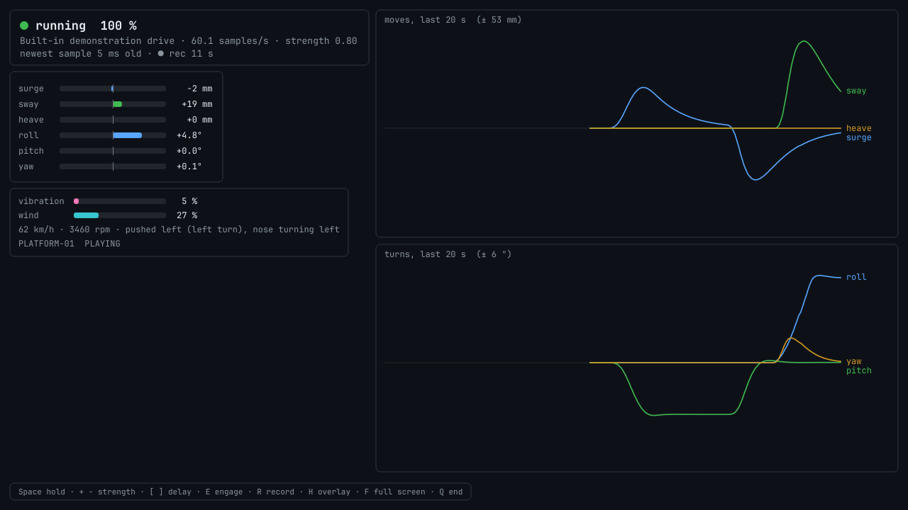

# Live mode — motion, effects and bass from a running game, a live picture or sound

A programme is made before the show: a video is analysed, the result is checked, and one `.motion`
file is played. **Live mode has no file.** A *source* says what is happening right now, and the
platforms, the DMX effects and the shakers follow it within a few hundredths of a second:

```
 game telemetry ─┐                     ┌─► platforms   (the show service's own runtime, limiter, kinematics)
 open format    ─┤                     │
 screen capture ─┼─► checks ─► cueing ─┼─► DMX effects (the venue patch and its limits)
 sound          ─┤   and fades         │
 recorded session┘                     └─► shakers     (sound card or ESP32 audio)
```

It runs on the show PC as `fourdvr live run`, without the Control Server, and uses the same
platform profiles, the same venue patch and the same limits as a programme. A live session can be
recorded and made into a programme afterwards (§11) — that is how an experience that is not a
video becomes a 4D programme.

**Before anything moves:** read §7 (what happens when things go wrong) and do §4 (directions) with
nobody on the platform. The safety notes of the [README](../README.md#safety--read-before-connecting-anything)
apply to live mode without exception: the limits here are numerical, the emergency stop is
hardware.

---

## 1. Try it in two minutes

No game, no platform, no hardware:

```bash
fourdvr live run --source demo --window        # a made-up 40-second drive, again and again
```

The window shows the state, the six axes, the effect levels and what the platform is asked to do;
the shakers' sound plays on this computer. With a simulated platform and the venue's example patch:

```bash
fourdvr live run --source demo --window --simulate \
        --platform config/platforms/example-electric-6dof.toml --patch config/effects/patch.example.toml
```

Playing a game's part, to test the network path and a real configuration before the game is there:

```bash
fourdvr live sim --format forza --to 127.0.0.1:5300 &      # sends the same drive as Forza packets
fourdvr live run --source forza --port 5300 --window
```

`fourdvr live sim` exists for every telemetry format.

## 2. Sources

`fourdvr live sources` prints this list with what to switch on in each game.

| `type` | For | Port | Delivers | Notes |
|---|---|---|---|---|
| `open` | your own experience (Godot, Unity, Unreal, anything) | 47010 | everything, plus effects it states itself | [LIVE_FORMAT.md](LIVE_FORMAT.md); senders: `fourdvr live sender godot` |
| `forza` | Forza Motorsport (2023), Motorsport 7, Horizon 4 / 5 / 6 | 5300 | motion, rotation, revs, road surface, puddles | any "Data Out" packet format |
| `f1` | F1 23, 24, 25 | 20777 | motion, rotation, revs, kerbs, rain | UDP format 2023, 2024 or 2025 |
| `dirt` | DiRT Rally, DiRT Rally 2.0, DiRT 4, GRID (2019) | 20777 | motion, revs; rotation worked out | `extradata="3"` |
| `pcars2` | Project CARS 2 / 3, Automobilista 2 | 5606 | motion, rotation, revs, terrain, rain, snow | UDP protocol "Project CARS 2" |
| `assetto` | Assetto Corsa (the original) | 9997 | g-forces, revs; turning rate worked out | needs `host` (the game PC) |
| `outsim` | Live for Speed | 4123 | motion, rotation; revs from OutGauge | OutSim and OutGauge to the same port |
| `beamng` | BeamNG.drive | 4444 | motion, rotation; revs from OutGauge | directions least certain — check all six |
| `xplane` | X-Plane 10 / 11 / 12 | 49005 | g-loads, rotation, airspeed, RPM | Data Output rows 3, 4, 16, 17 (37) |
| `flightgear` | FlightGear | 47011 | motion, rotation, airspeed, touchdown, rain, snow | `fourdvr live sender flightgear` writes its protocol file |
| `gt7` | Gran Turismo 7 | 33740 | speed, turning, revs; accelerations worked out | **experimental**; needs `host` (the console) |
| `screen` | anything with a moving picture | — | motion estimated from the picture | §9 |
| `sound` | anything with sound | — | bass for the shakers, vibration, thumps | §10 |
| `replay` | a recorded session | — | what was recorded | `file = "x.4dlive"` |
| `demo` | nothing needed | — | the made-up drive | |

Where each format is published, exactly what is read from it and how certain each direction is:
[TELEMETRY_FORMATS.md](TELEMETRY_FORMATS.md). Games that are not here, and games without
telemetry: the picture (§9), the sound (§10), or a small sender of the open format.

## 3. A configuration

`fourdvr live example-config -o live.toml` writes a commented file; `fourdvr live check -c live.toml`
says what it means and whether it can run. The package has two files to start from:
`config/live.example.toml` (the same text) and `config/live-bench.example.toml` — one simulated
platform and the demonstration drive, runnable as it is, with a game, a picture and sound as source
in comments.

```toml
[live]
controller = "controller.toml"   # platforms, addresses, limits and the effects patch of the show service
# record = "sessions"            # record every run into this folder
# hold = true                    # start held: nothing moves until the operator releases it

[source]
type = "forza"
port = 5300

[axes]                           # §4: turn a direction round with -1, switch it off with 0
# yaw = -1.0

[cueing]
gain = 0.7                       # overall strength 0..2 - start low
```

| Section | Keys |
|---|---|
| `[live]` | `controller` (the show service's file — recommended), `rate_hz` (without a controller file; 50–200, default 100), `record` (folder), `hold`, `sound` (without a patch: shaker sound on this computer, default on), `latency_compensation_s` |
| `[[platforms]]` | without a controller file: `config` (profile), `id`, `address`, `driver`, `link_platform_id` |
| `[effects]` | without a controller file: `patch`, `reference_platform` |
| `[source]` | `type`, and per type `port`, `bind`, `host`, `file`, `loop` — picture and sound sources: §9, §10 |
| `[axes]` | `surge`, `sway`, `heave`, `roll`, `pitch`, `yaw`: a factor on what the source delivers |
| `[cueing]` | `gain` (0–2), `axis_gains` (per axis), `accel_scale` (0.2: how much of the vehicle's real acceleration the seat shows), `peak_specific_force` (2.5 m/s²: where it saturates softly), `rotation_gain` (0.6), `max_tilt_deg` (7), `tilt_rate_deg_s` (5), `tilt_coordination`, `input_lp_hz` (8), `comfort` (1), the washout frequencies |
| `[safety]` | `stall_s` (0.25), `resume_s` (0.5), `fade_out_s` (1.0), `fade_in_s` (2.5) |
| `[rules]` | §6 |
| `[shaker]` | §6 |

A key that is not known is an error, not ignored. Without `-c`, the same can be given on the
command line: `--source`, `--port`, `--host`, `--gain`, `--axis yaw=-1`, `--platform PROFILE`
(several times), `--simulate`, `--patch`, `--hold`, `--record`.

With `controller = …` the live show takes over the platforms that the show service normally
drives. **Stop the show service first**: two programs must not command the same board.

## 4. Checking the directions — once per game, with nobody on the platform

Games mostly do not publish which way a positive value points, and no game was available when this
was written ([TELEMETRY_FORMATS.md](TELEMETRY_FORMATS.md) says for every value whether its
direction is stated, conventional or assumed). So this check is part of setting up a game, like
checking the direction of a motor:

```bash
fourdvr live monitor --source f1            # no platform, no effects: only what the source says
```

Drive, and compare what you do with what it prints:

| Do this in the game | It must say | If it says the opposite |
|---|---|---|
| accelerate hard | `speeding up` | `--axis surge=-1` |
| brake hard | `braking` | (the same axis) |
| a long left bend | `pushed left (left turn)` **and** `nose turning left` | `--axis sway=-1` / `--axis yaw=-1` |
| drive over a crest | `lifted`, then `pressed into the seat` in the dip | `--axis heave=-1` |
| brake so that the nose dips (or push the stick forward) | `nose going down` | `--axis pitch=-1` |
| a right bend in a soft car (or roll right) | `rolling right` | `--axis roll=-1` |

Try the factors on the command line, then write them into `[axes]`. A direction that says nothing
at all is not delivered by that format (the table in §2); that is not an error.

Then, still with nobody on the platform and `gain = 0.3`: run the show and watch the platform do
the same things — nose up when accelerating, leaning right side down in a left bend. Only then
raise the gain, and only then let somebody sit on it.

## 5. What the platform does

The same four ideas as for a programme ([MOTION_ALGORITHM.md](MOTION_ALGORITHM.md)), with the same
filters, but strictly in real time:

* the **onset** of an acceleration becomes a short movement that washes out again;
* a **sustained** acceleration becomes a slow tilt (at most `max_tilt_deg`, no faster than
  `tilt_rate_deg_s`), so that gravity supplies the feeling: nose up while speeding up, right side
  down in a left bend;
* the **onset** of a rotation becomes a rotation that washes out;
* everything is scaled (`accel_scale`, `gain`) and saturates softly, so that a crash in the game is
  a strong cue and not a violent one.

Each platform then bends that cue softly into nine tenths of **its own** range and runs it through
its own limiter, kinematics and actuator guard — the code that plays programmes, unchanged. Several
platforms get the same cue. The limiter rarely has to do anything with telemetry; with a picture
as source it works more often (§9). `fourdvr live run` reports at the end how often it did.

What it costs in time, measured here on a two-core 2.1 GHz virtual machine: a telemetry packet is
used at the next control period (10 ms at 100 Hz; the window showed samples 2–13 ms old), and the
smoothing of the incoming values (`input_lp_hz = 8`) adds about 0.03 s.

## 6. Effects and shakers

Effect levels are made from each sample and handed to the unchanged effects engine in the place of
a programme's effect tracks. **The venue patch, its masters and every fixture's limits apply
exactly as in a show** — a game that reports rain for ten minutes gets what the rain fixture's
limits allow.

| Effect | From | `[rules]` |
|---|---|---|
| wind | speed | `wind` (on), `wind_start_m_s` (3), `wind_full_m_s` (55 ≈ 200 km/h) |
| seat vibration | revs and throttle, road surface, sliding tyres | `vibration`, `vibration_engine` (0.35), `vibration_road` (0.8) |
| air blast | a hit (collision, landing) | `air_on_impact`, `impact_threshold` (0.35), `air_seconds` (0.3) |
| water spray | puddles and water under the wheels, where the game reports them | `water_on_splash` |
| rain, snow | the game's weather (F1, Project CARS 2, FlightGear) | `stated` |
| anything else | what an `open` sender states itself; scenes of a captured picture (§9) | `stated` |
| strobe | only what a source states, **and only if** `strobe = true` | `strobe` (off) |

Two differences from a programme, by nature: a fixture's **lead time** cannot be honoured (nobody
knows what the game does next), and the limits' **"per show" totals** start again every
`show_minutes` (15).

**Shakers** get sound made as the show runs: an engine tone that follows the revs
(`engine_low_hz` 28 to `engine_high_hz` 85), road rumble, a thump at every hit — `[shaker]`:
`engine`, `engine_level` (0.5), `road`, `road_level` (0.6), `impacts`, `impact_level` (0.9),
`impact_hz` (42). It goes to the patch's bass outputs: the sound card of the show PC or the ESP32
audio nodes ([ESP32_EFFECTS_LINK.md](ESP32_EFFECTS_LINK.md)). Without a venue patch it plays on this
computer's default sound output (`--no-sound` turns that off).

## 7. What happens when things go wrong

| Situation | What the show does |
|---|---|
| the source sends something that is not a number | that sample is refused and counted |
| a value is absurd (beyond 8 g, 12 rad/s) | it is cut to that; the soft saturation of the cueing makes even that a bounded cue |
| a packet is not the format (wrong size, wrong marker) | refused and counted (`invalid` in the status) |
| **no fresh sample for `stall_s`** (game closed, cable pulled, stream stuck) | motion and effects **fade to rest** in `fade_out_s`; the platform returns to neutral |
| the game says it is paused / in a menu / in a replay | the same |
| the source comes back | after `resume_s` of steady data the show fades back in over `fade_in_s`; a hiccup shorter than the fade costs a dip, not a restart |
| the operator presses Space | the same fade to rest, until released |
| a platform's board reports a fault, or does not answer | that platform parks, **and stays out until the operator presses E** (unless its profile says `fault_recovery = "auto"`); its own effects stop with it; the other platforms carry on |
| no platform is following | theatre effects rest too |
| an effects problem (no DMX node, no sound card, a bad patch) | reported; motion is never stopped or delayed by it |
| the live window is closed, crashes or is killed | the show — which runs in a process of its own, §8 — fades to rest, brings the platforms to neutral and ends |
| the live window stops answering (3 s) | the show holds until the window answers again |
| the computer is so busy that the control loop is late | the board's own time-out parks the platform (a fault, as above); the end report says how late the loop ran and how often |

There is no way for a source to command a pose or a DMX value directly. Everything passes the
cueing and the limits.

## 8. The live window and the operator's keys

`fourdvr live run … --window` (it opens by default for a picture source in delay mode; from the
Editor: *Live ▸ Live show from a game or a picture…*).



With a picture source in delay mode the delayed picture fills the window and the panels lie over
it; with any other source the right-hand side shows what the platform was asked to do.

**The window is not where the show runs.** Grabbing a screen and painting a large picture keep
every other part of a Python program waiting — measured here: 55 ms for one grab of a 3840 × 2160
screen — and a platform's board that misses its commands for its time-out stops with a fault. So
with a window the show itself (source, control loop, platform links, effects, sound) runs in a
second process, which the window starts and talks to: the operator's keys go there, the status
comes back twenty times a second, and the samples of a picture source — which is captured and
analysed where it is shown — go there too. Whatever the window does, the platforms get a command
every control period; if the window dies, the show ends at rest by itself.

| Key | |
|---|---|
| Space | hold / release |
| `+` `−` | strength, in steps of 0.05 |
| `[` `]` | picture delay −/+ 10 ms (picture source) |
| E | engage: acknowledge platform faults, release a hold |
| R | start / stop recording |
| H | hide / show the overlay |
| F | full screen |
| Q, Esc | end: fade to rest, platforms to neutral, then close |

Without the window the same keys work in the terminal (Space, `+`, `-`, `e`, `r`, `q`), and a
status line shows state, source rate, the newest values, effect levels and each platform's phase.

## 9. A picture as source

For a game without telemetry, a console on a capture card, a camera, a network stream — or a video
file, played in real time.

```toml
[source]
type = "screen"
capture = "screen"            # "screen" | "camera" | "stream" | "file"
# screen = 0                  # which monitor;  region = [x, y, width, height] in its pixels
# device = 0                  # camera / capture card (number or "/dev/video2")
# url = "rtsp://…"            # stream
# file = "ride.mp4"           # video file (loop = true to repeat)
projection = "flat"           # "flat" (with hfov_deg, default 90), "180" or "360"
mask = [[0.0, 0.75, 1.0, 0.25]]   # parts of the picture that are not the scene: HUD, dashboard, mirrors
                                  # (x, y, width, height as fractions of the picture)
mode = "delay"                # or "direct" - see below
delay_s = 0.35
motion_lead_s = 0.05
# scenes = true               # look for rain, fog, fire, snow, water and scent scenes (one picture a second)
# sound_device = "Monitor"    # also feed the shakers with the low end of this sound input (§10)
```

The camera's motion is estimated from each frame with the extractor's own tracking and ego-motion
estimate, then smoothed. A menu, a loading screen or a black picture (no usable picture for 1.5 s)
means rest; a cut is not carried across.

### The delay, and the two ways of living with it

A frame has to arrive, be analysed and be smoothed before there is motion. Measured here with a
360° ride video at 30 frames a second (640 × 360, analysed at 480 pixels width, two-core 2.1 GHz
virtual machine): the analysis took 17–34 ms per frame on average, 58 ms at the 95th percentile;
about one frame in fifteen to thirty arrived while the previous one was still being analysed and was
skipped. On top come the smoothing — about 0.03 s for rotations, 0.16 s for accelerations — and
0.05 s of input smoothing in the cueing.

**`mode = "delay"` — the picture is in our hands.** The live window shows every frame `delay_s`
after it was captured and sends the motion `motion_lead_s` before the frame appears (the lead is for
the platform's own lag). Motion and picture are in step, and the smoothing's lag is taken out of the
wait. This needs `delay_s` ≥ `motion_lead_s` + 0.21 s + the analysis time — 0.35 s is enough on the
machine above (measured: the motion sample left 103 ms after capture, 125 ms at the 95th
percentile, for a frame shown at 350 ms). If the analysis is too slow for the delay, the window
counts the samples that were *late*: raise the delay with `]`.
Use it wherever the audience watches the window: a second screen or a projector fed by the show PC.
Sound that the audience hears directly is then earlier than the picture by `delay_s`; the shakers
(`sound_device`) are delayed to match.

**`mode = "direct"` — the picture is not in our hands** (the rider plays on the game's own screen).
The motion comes as early as it can — the sample leaves about 0.02 s after capture here (0.06 s at
the 95th percentile) — and is then still late by the smoothing: roughly **0.1 s for rotations and
0.25 s for accelerations**, plus whatever the capture device adds. So the fast part of the cueing is
halved (`comfort = 0.5` is set automatically) and what tolerates lag carries the show: the slow
tilt, vibration, bass, wind and the other effects. Sharp jolts in step with the picture are not
possible this way; telemetry is the answer for that.

What the capture device adds can be measured where the show PC's own output is what gets captured:

```bash
fourdvr live calibrate -c live.toml       # shows a black/white pattern and times it in the captured picture
```

### What a picture cannot give

* **A scale.** "How strong" is learned from the picture's own recent past: the strongest tenth of
  the last minute counts as a strong acceleration (`strength`, 7 m/s²), and a moment stronger than
  anything before lowers the gain at once. Set the overall strength with the gain.
* **Smoothness.** The estimate is rougher than telemetry: with the roller-coaster video the
  platform's limiter had to hold back the jerk in about 2.5 % of the control periods (100 of 4000).
  It does that without harm; a lower gain makes it rarer.
* **Speed, revs.** No wind from speed, no engine tone; vibration comes from how much the picture
  shakes. With `scenes = true` (and the scene models, [SCENE_DETECTION.md](SCENE_DETECTION.md)) rain,
  fog, fire, snow, bubbles, water and scent scenes become effects.

### Grabbing the screen itself

`capture = "screen"` is done by the live window and works under **X11**. A **Wayland** session does
not let a program read the screen this way: the window says so, and the ways out are a capture card,
a stream from the game PC (OBS can send one), or an X11 session. Do not capture the screen that
shows the live window itself; give it a region or another monitor.

Reading a screen takes time that grows with its size. Measured on the machine above (a virtual
X server, no graphics card): 7 ms for 1280 × 720, 13 ms for 1920 × 1080, 55 ms for 3840 × 2160 —
so a 4K screen gives at most some 15 pictures a second this way. Run the game at 1920 × 1080 or
give a `region`; the analysis itself works on a picture 480 pixels wide whatever is grabbed.

## 10. Sound as source

```toml
[source]
type = "sound"
device = "Monitor"            # part of the name of a sound input; "" = the default input
# cutoff_hz = 120
# kick = 6.0                  # m/s² of downward jolt at the strongest thump (0: none)
```

The low end of the sound goes to the shakers a few hundredths of a second after it was captured;
its loudness becomes seat vibration; a sudden thump becomes a thump in the shakers, an air blast if
it is strong, and a small jolt of the platform. On PulseAudio and PipeWire the devices named
"Monitor of …" carry what the computer itself plays. `file = "x.mp3"` plays a file's sound instead
(for trying it out).

## 11. Recording, and from a session to a programme

`--record [FILE]` (or `[live] record = "folder"`, or R in the window) writes a `.4dlive` file: what
the source delivered, on the control grid, with the directions already corrected, plus the effect
levels and the pose the live cueing made of it.

```bash
fourdvr live info lap.4dlive
fourdvr live convert lap.4dlive -o lap.motion --platform platforms/seat.toml --programme-id 7
```

`convert` makes a programme of it with the Editor's own offline stages — the perceptual cueing with
zero-phase smoothing and a gain chosen from the whole recording, the fit to one platform's limits,
the validation — and adds the session's effects as tracks (wind and vibration as curves, the rest as
cues) and the shakers' sound as the bass track. Options: `--gain`, `--kind car|aircraft|ride`,
`--start` / `--end` (seconds), `--no-effects`, `--no-bass`.

**A programme belongs to a video.** The Control Server accepts a motion file only together with
the video it was made for: the file names that video (its SHA-256) and must have its length. So
record the session on video as well — a screen or 360° capture made at the same time — and give it
to the conversion:

```bash
fourdvr live convert lap.4dlive --video lap.mp4 -o lap.motion --platform platforms/seat.toml --programme-id 7
```

The programme then covers exactly the video: its length, its reference, motion and effects on its
clock. The two recordings need not start together: where the video begins in the session is found
by comparing how the picture turns with what the session recorded (`fourdvr live align lap.4dlive
lap.mp4` only reports it). That works when the camera turns with the vehicle — a cockpit or
first-person view; for a view that does not (a chase camera with little turning, a fixed camera),
or when the answer is refused as unsure, give the second yourself with `--offset`: the second of
the session at which the video begins (negative if the video began first). Parts of the video
outside the session stay at rest. `--projection` and `--stereo` say what kind of video it is if
the guess from its name and shape is wrong. Without `--video` the file can be looked at, edited
and tried in the Editor, but not published.

**In the Editor:** *File ▸ Open* a `.4dlive` file. It asks for the video of the session (or *No
video*), makes the programme next to the session for the platform chosen in the *Programme* tab
and opens it like any `.motion` file, with the video attached for the preview: look at the
motion, change the effects on the timeline, Check, Export.

A recorded session can also be played again as a source (`type = "replay"`): the same show, without
the game.

## 12. On a show PC

Telemetry sources, the open format, `replay` and `demo` need nothing beyond the show installation
(`pip install "extended-4d-editor[show]"`, or the AppImage). A picture source, `convert` and the
window need the workstation packages (`[studio]`; all in the AppImage).

## 13. What was tested, and what was not

**Tested** (automated; `tests/live`, and the end-to-end test `integration/run_live_integration.py`
— a simulated game, the live show, two simulated boards and a DMX receiver as separate parts over
real UDP, then the Control Server):

* every telemetry decoder against packets built from the published layouts — sizes equal to the
  published ones, the drive comes back, anything that is not the format is refused; the Salsa20
  implementation against an independent one;
* the request-driven formats (Assetto Corsa handshake, GT7 heartbeat) against the simulator, over
  UDP on one machine;
* the real-time filters against the offline ones (identical output), tilt directions and limits,
  the fades for stall, pause, hold and return;
* a simulated platform (the ESP32's own protocol and guard code) through a whole drive: inside its
  limits, a fault handled, back to neutral when the source stops;
* effects through the engine with a venue patch: levels, limits, the air blast, the bass feed;
* the picture path with a rendered camera rotation of known size and direction (the turning rate
  came out within 8 %, with the right sign), cuts, a black screen, masks, both delay modes in real
  time with a video file; the sound path with a sound file;
* recording, conversion, the Editor opening a session, the command line, the window (off-screen);
* the show in a process of its own: the operator's calls, a picture source on the window's side,
  the window gone (the show ends at rest, the platform parked) and not answering (held, then on);
* on an X server (Xvfb): the live window grabbing the part of the screen in which another window
  pans a picture — 30 pictures a second grabbed, the turning rate found within 3 % with the right
  sign, the delayed picture shown, the platform in the other process following, its control loop
  at most about 20 ms late — and the delay test finding its pattern in the grabbed screen;
* a programme for a video of the session: a rendered video found in the session by its picture
  (flat and 360°), and the Control Server refusing the programme made without the video and
  accepting and publishing the one made for it.

**Not tested — because none of it exists in the test environment:**

* **any real game, console or simulator.** The directions of §4 are therefore checked by you;
* a capture card, a camera, a network stream; grabbing a real desktop with a graphics card and a
  compositor (X11), and any Wayland session;
* a real sound input;
* real platforms, DMX devices, shakers; an ESP32 board (as for the rest of this product);
* the Godot and Unity senders inside those engines;
* how any of this *feels*. The defaults are cautious starting points, not tuned on people.

## 14. When something is not as expected

| What you see | What it means |
|---|---|
| `waiting for the source`, rate 0 | nothing arrives: wrong IP or port in the game, a firewall, the game not in a session. `fourdvr live sim` proves the path from another machine |
| packets arrive, `invalid` counts up | the game sends another format (F1: set "UDP Format"; DiRT: `extradata="3"`; Project CARS: protocol "Project CARS 2") |
| `cannot listen on UDP port` | another program has the port (often a dashboard app); most games can send to two ports, or use another |
| the platform moves the wrong way | §4 |
| `source stalled` again and again | packets arrive less often than `stall_s` (set the game's send rate to 60) or the network drops them |
| a platform shows `FAULT` | see its reason; clear the cause, press E |
| motion feels late with a picture source | §9: "delay" mode, or accept the limits of "direct" |
| many `late` samples in the window | the analysis is slower than the delay leaves room for: raise the delay, lower `width` or `fps` |
| the screen grab is black | Wayland, §9 |
| `no sound: …` | no sound device on this computer, or the sound library is missing (`pip install "extended-4d-editor[show]"`) |
| the Control Server refuses a programme made of a session | it needs the video of the session: §11 |
