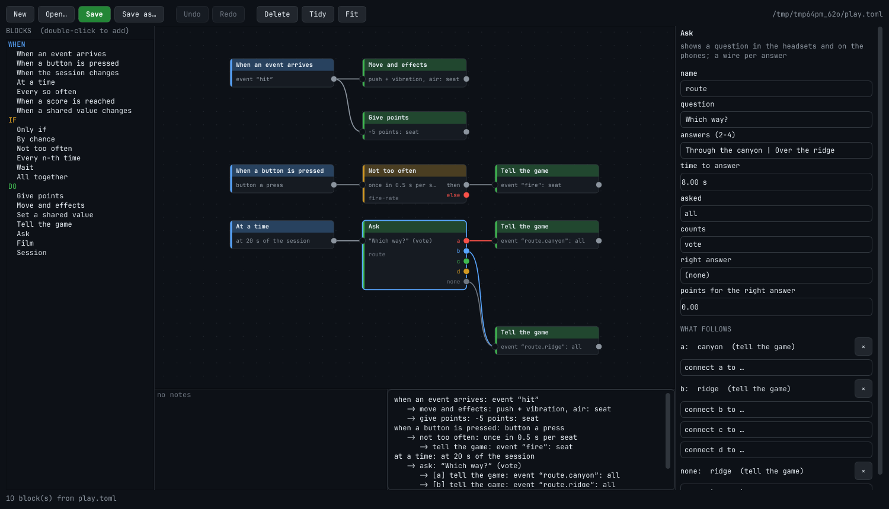
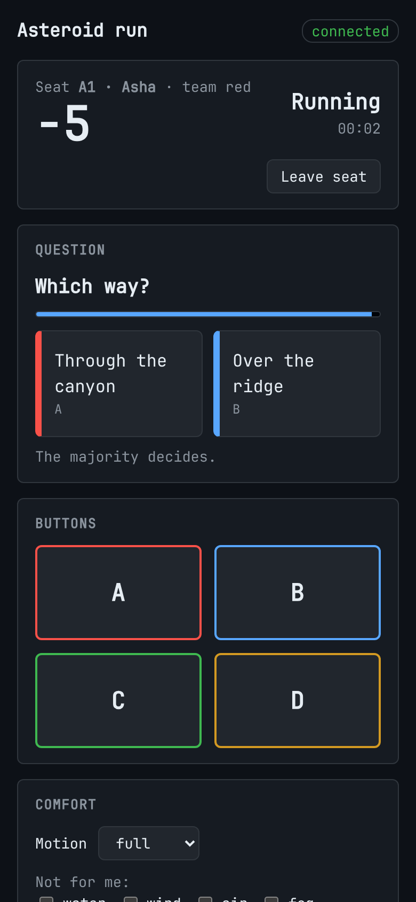
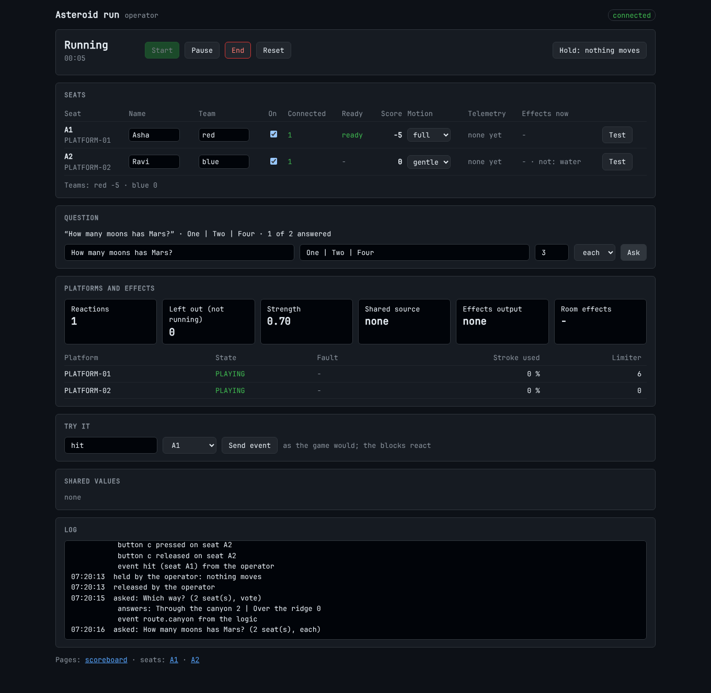
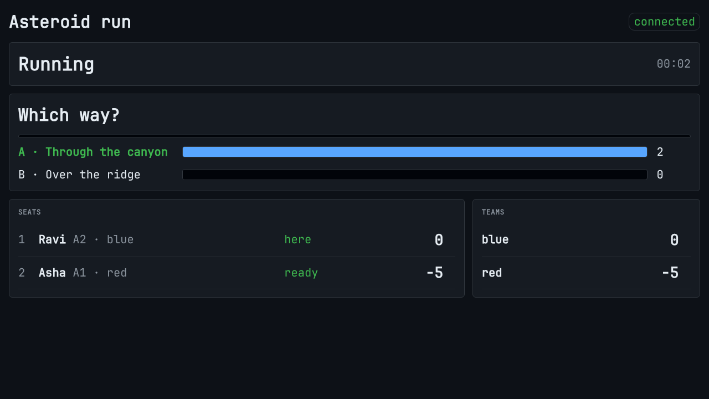

# The interactive mode: seats that take part

A 4D film does the same to every seat. In the interactive mode every seat is somebody: it has its
own motion and effects, buttons, a score and a team, and the audience is asked questions - in a game,
or inside a film. The trade sells this as "5D", "6D", "7D" and so on; those names have no fixed
meaning. What they come to is 4D plus interaction, and that is what `fourdvr play` adds:

* **every seat its own motion and effects** - from a game's telemetry per seat, and from *reactions*
  (a push, a shake, wind, water ... for the seat that was hit);
* **shared interaction** - events, scores per seat and per team, values everybody sees, votes;
* **questions** in the headsets, on phones and on a scoreboard, answered by looking, by a controller,
  by a button on the seat or by a phone;
* **questions inside a film** the Control Server plays, including decision points where the film
  waits for the vote and then goes on or changes to another programme;
* **the logic as blocks and wires**, drawn in the Editor or written in the configuration file -
  no programming for "when a seat is hit, push it back and take five points".

Nothing of the film side changes: `.motion` files, the show service, the Control Server and the
venue patch are as they were. The interactive mode is built on the live mode ([LIVE.md](LIVE.md)) and
uses its cueing, its limits and its safety rules.

1. [Try it on one PC](#1-try-it-on-one-pc)
2. [The parts, and who talks to whom](#2-the-parts-and-who-talks-to-whom)
3. [The show's file: play.toml](#3-the-shows-file-playtoml)
4. [The logic: blocks and wires](#4-the-logic-blocks-and-wires)
5. [The Interaction window](#5-the-interaction-window)
6. [The game's side](#6-the-games-side)
7. [Seats: buttons, phones, headsets](#7-seats-buttons-phones-headsets)
8. [Running a session](#8-running-a-session)
9. [Questions inside a film](#9-questions-inside-a-film)
10. [Safety and comfort](#10-safety-and-comfort)
11. [What was tested, and what was not](#11-what-was-tested-and-what-was-not)

The messages themselves are in [PLAY_PROTOCOL.md](PLAY_PROTOCOL.md), the commands in
[CLI.md](CLI.md#fourdvr-play--the-interactive-mode).

## 1. Try it on one PC

No platform, no board, no headset and no game are needed:

```bash
fourdvr play example-config --bench -o play.toml   # the example show and a platform profile next to it
fourdvr play check -c play.toml                    # what the file says, in words
fourdvr play run -c play.toml --simulate           # two simulated platforms; prints the addresses and the key
```

`run` prints four addresses: the **operator** page (with its key), the **seats** page for phones, the
**scoreboard** and the address for the **game**. Open the operator page in a browser, the seats page
in a second window (take seat A1), and press **Start** (or `s` in the terminal). In a second
terminal, simulated players and a simulated game play along:

```bash
fourdvr play bots -c play.toml --game
```

The example show: a seat that is hit is pushed back, shaken and loses five points; button A tells
the game "fire" (at most twice a second per seat); twenty seconds in, everybody is asked "Which
way?" and the majority decides. `Ctrl+C` (or `q`) ends `run`; it prints the result.

## 2. The parts, and who talks to whom

```
                    ┌──────────────────────── fourdvr play run ────────────────────────┐
 game ── events, ──▶│  hub: seats, scores, teams, questions, the blocks                │──▶ platforms (one per seat)
 (Godot add-on,     │   │                                                              │──▶ effects: DMX / the seats' ESP32s
  any WebSocket     │   └─ per seat: its telemetry + reactions ─▶ cueing ─▶ limits     │──▶ shaker sound
  program) ◀─ buttons, answers, "tell the game" events                                 │
                    └───▲──────────────▲──────────────▲──────────────▲────────────────┘
                        │              │              │              │
                  seat buttons     phones        headsets       operator page,
                 (ESP32 boards)  (seat page)   (VR Player)       scoreboard
```

One program, `fourdvr play run`, is the **hub**. Everything else connects to it:

| Who | How | Port |
|---|---|---|
| the game (role `game`) | WebSocket `ws://HUB:47020/ws`, JSON messages; seat telemetry also over UDP | TCP and UDP 47020 |
| phones and tablets | the seat page `http://HUB:47020/` (role `player`) | TCP 47020 |
| headsets (VR Player 1.1.0) | WebSocket, role `headset`: the question panel | TCP 47020 |
| operator, scoreboard | `http://HUB:47020/operator`, `/scoreboard` | TCP 47020 |
| seat buttons | the seats' ESP32 boards, over the effects link ("4DFX" 1.1, [ESP32_EFFECTS_LINK.md](ESP32_EFFECTS_LINK.md)) | UDP 47002 |
| a film | the hub asks the Control Server's ordinary HTTP interface | the server's port |

The pages, their script and their font come from the hub itself: no Internet is needed. The port is
`port` in `[play]` (or `--port`); `bind` limits it to one network interface.

## 3. The show's file: play.toml

A `play.toml` is a live configuration ([LIVE.md](LIVE.md) §3: `[live]`, `[source]`, `[cueing]`,
`[safety]`, `[rules]`, `[shaker]`) with a `[play]` section. `fourdvr play example-config` prints a
commented one; `fourdvr play check -c play.toml` says what a file means and whether it can run
(`--strict`: notes count as errors).

```toml
[live]
controller = "controller.toml"   # platforms, limits and the venue's effects patch: the show service's own file

# [source]                       # optional: motion and effects every seat shares (a ride everybody is on);
# type = "open"                  # any source of 'fourdvr live sources'. Left out: only seats and blocks act.

[cueing]
gain = 0.7                       # overall strength, 0..2 - start low

[play]
title = "Asteroid run"
# port = 47020
# operator_key = "choose-a-key"  # left out: a new key at every start, shown in the terminal
# game_key = "choose-a-key"      # left out: any program on the network may be the game
countdown_s = 5
session_minutes = 0              # 0: until the operator or the game ends it
# max_events_per_s = 20          # per connection; more is left out and the sender is told
# shared_motion = false          # seats get only the room effects of [source], not its motion
# results = "results"            # a result file per session in this folder
# buttons = ["a", "b", "c", "d"] # names of the seat boards' inputs 1, 2, 3 ... (up to 8)

[[play.seats]]
id = "A1"
platform = "PLATFORM-01"         # the platform this seat sits on ("" or left out: a seat without motion)
team = "red"
# name = "Front left"
# motion = "gentle"              # full | gentle (half) | off - the rider can change it on the seat page
# blocked = ["water", "strobe"]  # effects this seat never gets

# [play.limits]                  # the most a block or a game may ask of a seat (the platform's own limits stay)
# max_accel = 4.0                # m/s²
# max_rate = 0.6                 # rad/s
# max_seconds = 3.0              # length of one push
# max_effect_seconds = 30.0
```

Without `[[play.seats]]` there is one seat per platform, named after it. Without
`controller = ...`, platforms and a patch can be listed in the file itself (`[[platforms]]`,
`[effects] patch = ...`, as in a live configuration); with neither, the show has scores and
questions only.

## 4. The logic: blocks and wires

The show's rules are **blocks**. A *when* block starts a signal, *if* blocks let it pass or not,
*do* blocks act. A wire leads from a block's output to the next block. In the file a block is a
`[[play.blocks]]` table with an `id`, a `type`, its settings, and `then` - the blocks it leads to:

```toml
[[play.blocks]]                  # when the game says a seat was hit ...
id = "hit"
type = "on_event"
event = "hit"
then = ["hit-jolt", "hit-points"]

[[play.blocks]]                  # ... that seat is pushed back and shaken
id = "hit-jolt"
type = "react"
accel = [-2.5, 0.0, 1.0]         # forward, left, up in m/s²
seconds = 0.25
effects = { vibration = 1.0, air = 0.8 }
effect_seconds = 0.6

[[play.blocks]]                  # ... and loses five points
id = "hit-points"
type = "score"
points = -5
```

A block with several outputs names them: `then = { a = ["canyon"], b = ["ridge"], none = ["ridge"] }`.
`pos = [x, y]` is where the Interaction window draws the block; it means nothing else.

A signal carries the **seat** it is about (and its team), a **value**, and after a question the
**choice**. "seat" in a block's `to` setting is that seat; the other targets are `team` (its team),
`others` (everybody else) and `all`.

| Block | What it does | Settings |
|---|---|---|
| **when** | | |
| `on_event` | the game, a page or another program sends this event | `event` |
| `on_input` | a button: on a seat's board, a phone, a controller | `button` (empty: any), `edge` = press \| release |
| `on_phase` | the session enters a phase | `phase` = lobby \| countdown \| running \| paused \| results |
| `on_time` | once, at this second of the session or of the film | `at`, `clock` = session \| film, `programme` (0: any) |
| `every` | again and again while the session runs | `seconds` |
| `on_score` | a seat's or a team's score reaches a number | `reaches`, `who` = seat \| team |
| `on_state` | a shared value is set | `key`, `equals` (empty: any change) |
| **if** | | |
| `filter` | passes for one seat, one team, a range of values or one choice; outputs `then`, `else` | `seat`, `team`, `min`, `max`, `choice` |
| `chance` | passes this often, at random; outputs `then`, `else` | `percent` |
| `cooldown` | passes at most once in this time; outputs `then`, `else` | `seconds`, `per` = seat \| all |
| `count` | passes on the n-th signal, then counts again | `n`, `per` = seat \| team \| all, `within` (s, 0: any time) |
| `delay` | passes the signal on later | `seconds` |
| `together` | passes once enough seats have signalled within the time; outputs `then`, `else` | `seconds`, `share` (of the seats, 0-1) |
| **do** | | |
| `score` | gives points (negative: takes them) | `points`, `to` |
| `react` | a push of the seat and effects for a moment | `to`, `accel`, `rates`, `seconds`, `effects`, `effect_seconds` |
| `set_state` | sets a shared value (a text), or adds to it | `key`, `value`, `add` |
| `send` | tells the game and the pages an event | `event`, `to` |
| `prompt` | asks; one output per answer: `a`, `b`, `c`, `d`, and `none` | `text`, `choices` (2-4), `seconds`, `to`, `mode` = each \| vote, `correct`, `points` |
| `film` | pauses, resumes or stops the film, or starts another programme | `action` = pause \| resume \| stop \| play, `programme` |
| `phase` | ends, pauses or resumes the session | `action` = end \| pause \| resume |

`fourdvr play blocks --settings` prints this list with the defaults.

**Questions.** `mode = "each"`: every seat answers for itself; with `correct = "b"` and `points`,
the right answer scores, and each seat's answer goes down its own wire. `mode = "vote"`: the
majority decides and one signal goes down the winner's wire (a tie: the earlier answer in the list).
A seat can change its answer until the time is up; the question closes early when everybody asked
has answered. One question per seat at a time: a new one takes the place of the old one. While a
question is open, the seat buttons a-d answer it instead of starting `on_input` blocks.

**Rules that keep a show from running away.** A circle of wires must pass through a block that
takes time (`delay`, `prompt`, `together`), or the file is refused. One signal may run through at
most 400 blocks; a score that sets off a score, and so on, stops at eight levels. What is left out is
counted and shown to the operator. Timers run on the session's clock: they stand still while the
session is paused.

**The logic in words.** `fourdvr play check` writes the blocks out as sentences ("when an event
arrives: event “hit” -> give points: -5 points: seat"), and so does the Interaction window. Read
them once before a show: it is the quickest way to see a wire that leads nowhere.

## 5. The Interaction window

*Live > Interactive show: blocks and wires…* (`Ctrl+Shift+I`) opens a `play.toml` as a drawing.



* The list on the left holds the block types; double-click one to add it, or right-click an empty
  place in the drawing.
* Pull a wire from a dot on a block's right side to another block. Choose a wire or a block and
  press `Del` to remove it. Blocks are moved with the mouse; *Tidy* puts them in columns in the
  order things happen, *Fit* shows them all.
* The panel on the right has the chosen block's settings and wires, the notes of the check, and
  the logic in words.
* `Ctrl+Z` / `Ctrl+Shift+Z` undo and redo, `Ctrl+D` duplicates, `Ctrl+S` saves, the mouse wheel
  zooms.

Saving rewrites **only the blocks** of the file: every other line - your comments, the seats, the
cueing - stays as it is, and the window refuses to save if it cannot guarantee that. The blocks
themselves are written anew, at the end of the file: comments on and between the
`[[play.blocks]]` tables are not kept, and every block gets its `pos` line. A file whose
blocks are written as one inline list (`blocks = [...]`) is not rewritten; use `[[play.blocks]]`
tables. The window edits the file; it does not talk to a running session - restart `fourdvr play
run` to use what you saved.

## 6. The game's side

A game says what happens ("seat A2 was hit"), may send each seat's motion, and hears buttons,
answers and whatever the blocks tell it. It does not need to know about platforms, limits or DMX.

**Godot 4.** `fourdvr play addon -o MY_GODOT_PROJECT` writes the add-on to `addons/fourd_theatre`.
Switch it on under *Project Settings > Plugins*; it adds the autoload `FourD`:

```gdscript
func _ready() -> void:
    FourD.input_received.connect(_on_button)      # a seat's buttons (board, phone, headset)
    FourD.event_received.connect(_on_event)       # what the blocks "tell the game"

func _on_player_hit(seat: String) -> void:
    FourD.event("hit", seat)                      # the blocks decide: points, a jolt, effects ...
```

A `FourDSeatMotion` node under a vehicle sends that seat's telemetry. The add-on's own
`README.md` lists every call and signal. The add-on was checked for syntax only: **it has not been
run in Godot** (§11).

**Python.**

```python
from fourdvr_play.client import PlayClient

with PlayClient("ws://192.168.10.2:47020/ws", role="game") as hub:
    hub.event("hit", seat="A1")
    hub.motion("A1", accel=[1.2, 0.0, 0.0], speed=14.0)
    message = hub.recv(timeout=0.1)               # {"type": "input", "seat": "A1", "button": "a", ...}
```

**Anything else** that can open a WebSocket and write JSON: [PLAY_PROTOCOL.md](PLAY_PROTOCOL.md).
From a shell, for scripts and tests: `fourdvr play send event hit --seat A1`.

**A seat's own motion** is the open live format ([LIVE_FORMAT.md](LIVE_FORMAT.md)) with one more
key, `"seat"`: over the WebSocket as a `motion` message, or as UDP datagrams to the hub's port
(`{"4dlive": 1, "seat": "A1", "accel": [...], ...}`). The hub makes the platform's motion of it with
the live mode's cueing; a seat whose telemetry stops comes to rest by itself. Motion messages are
not counted against `max_events_per_s`.

## 7. Seats: buttons, phones, headsets

**Buttons on the seat.** Up to eight inputs on the seat's ESP32, firmware 1.2.0. The build
`wt32-eth01-buttons` is a platform board with two buttons; any other build gets buttons with
`-D FDVR_INPUT_COUNT=N`. Wiring, pins and settings are in
[ESP32_EFFECTS_LINK.md](ESP32_EFFECTS_LINK.md). The board debounces (20 ms) and reports every
change three times; the hub names input 1 "a", input 2 "b" and so on (`buttons` in `[play]`).
`fourdvr fx nodes` and the venue check show whether a board has buttons.

**Phones and tablets.** `http://HUB:47020/` is the seat page: choose a seat, give a name, then a
score, four buttons, the question when there is one, and the rider's own comfort settings. The
operator page lists a link per seat (`/?seat=A1`) to put on a seat's tablet or into a QR code.
A page finds the hub again by itself after a restart.



**Headsets.** VR Player 1.1.0 shows a question as a panel in front of the viewer: look at an answer
for a moment (1.2 s by default), or point and press the trigger; on a PC, keys 1-4. Two settings
in the player's `config.json`: `play_url` (`ws://HUB:47020/ws`) and `seat`. Without `play_url` the
player is as before.

## 8. Running a session

```bash
fourdvr play run -c play.toml            # --simulate: simulated platforms   --no-outputs: logic only
                                         # --hold: start held   --start: start at once   --seconds N: end by itself
```

A session goes **lobby → countdown → running ⇄ paused → results**, and with *Reset* back to the
lobby. Seats and effects move only while it is running and not held.

| Key | | Key | |
|---|---|---|---|
| `s` | start | `Space` | hold / release: nothing moves |
| `p` | pause, resume | `e` | go on after a platform fault |
| `x` | end | `+` `−` | strength |
| `r` | reset to the lobby | `q` | quit |

**The operator page** (`/operator`, with the key) does the same and more: seats with names, teams,
scores, what each rider has switched off, a *Test* push per seat, a question to ask everybody,
"send event" to try the blocks without a game, the platforms' state, and a log.



**The scoreboard** (`/scoreboard`) is for a screen in the room: phase and time, seats and teams in
order, the open question and - when its time is up - how the room answered.



**Results.** At the end the hub sends everybody the result, prints it, and with `results =
"folder"` writes `results-DATE-TIME.json`: place, score, answers, right answers and reactions per
seat, the teams, the questions asked and the shared values.

`fourdvr play status --key KEY` prints what a running session is doing (`--json` for scripts);
the same is at `http://HUB:47020/api/status?key=KEY`.

**Keys.** The operator key opens the operator page and `fourdvr play send phase ...`; without
`operator_key` in the file a new one is made at every start. With a `game_key`, a program must give
it to be the game. The traffic is not encrypted: the hub belongs in the theatre's own network, not
on the Internet.

## 9. Questions inside a film

The Control Server plays the film as always; the hub follows it and asks. Add to the show's file:

```toml
[play.film]
server = "http://192.168.10.2:8080"     # the Control Server
user = "operator"                       # an operator account if blocks steer the film; a viewer account
password_file = "server-password.txt"   # is enough to follow it (or the environment: FOURDVR_SERVER_PASSWORD)
# poll_s = 0.25                         # how often the film's position is read
```

and run the hub **without outputs**, on any PC of the theatre's network:

```bash
fourdvr play run -c film.toml --no-outputs
```

During a film the platforms and the effects belong to the film - the show service plays its
`.motion` file. The hub adds questions, scores and what the film does next. (A `react` block then
reaches the phones and the game only.)

**The film leads.** PLAY at the Control Server starts the session - the riders see a countdown over
the server's start lead -, a pause there pauses it, STOP ends it with the results. One showing is
one session: when the film begins again (a loop, RESTART) or another programme starts, the results
are given and a new session begins. Start, pause and end on the operator page are switched off;
Hold, the seats and "ask a question" work. If the Control Server does not answer for five seconds,
the session pauses until it is back.

**Cues** are `on_time` blocks with `clock = "film"` (and `programme = N` if they belong to one
programme). **The `film` block** pauses, resumes or stops the film or starts another programme.
A pause asked for by a block is a **decision point**: the film waits, the session and the
question's time go on.

```toml
[[play.blocks]]                  # one minute in: the film waits while the audience votes
id = "fork"
type = "on_time"
clock = "film"
programme = 1
at = 60.0
then = ["wait", "ask"]

[[play.blocks]]
id = "wait"
type = "film"
action = "pause"

[[play.blocks]]
id = "ask"
type = "prompt"
text = "Into the cave?"
choices = ["Go on", "Into the cave"]
seconds = 15
mode = "vote"
then = { a = ["go-on"], b = ["cave"], none = ["go-on"] }

[[play.blocks]]
id = "go-on"
type = "film"
action = "resume"

[[play.blocks]]
id = "cave"
type = "film"
action = "play"
programme = 2
```

What a film cannot do: **jump to a time**. The Control Server has no such command, so a branch is
another programme, not another place in the same file.

**Timing.** The hub reads the film's position every `poll_s`; a cue is that much late at most, plus
the network. The Control Server schedules its commands ahead so that all headsets act together: a
pause takes effect half a second after it is asked, a resume a second, a new programme after the
server's transition gap and start lead. In the test of §11 the question of a cue at 6.0 s appeared
at film position 6.0-6.1 s, and the film stood at 6.6-6.7 s.

**Seat buttons in a film.** A seat's board talks to one controller, and during a film that is the
show service. It passes the buttons on if its `controller.toml` says where to:

```toml
[effects]
patch = "effects/patch.toml"
buttons_to = "ws://192.168.10.2:47020/ws"   # the hub
# buttons_key = "..."                       # the hub's game_key, if it has one
```

The platform ids must be the same in both files: the hub finds the seat by its platform.

**Headsets** need `play_url` and `seat` (§7). The question panel is hidden while the screen is
black between programmes.

## 10. Safety and comfort

* **A push is a request, not a position.** A reaction is an acceleration for a moment. It goes
  through the live mode's cueing, then the same soft limit, limiter and platform runtime as a film.
  Nothing a block, a game or a page sends can move a platform beyond its profile's limits; the test
  suite asks for the worst case and checks it. On the example platform, 3 m/s² for 0.25 s is about
  13 mm of travel, 4 m/s² for 0.5 s about 42 mm, 0.5 rad/s for 0.4 s about 2°.
* **`[play.limits]`** caps what may be asked for at all; larger requests are cut down, longer ones
  shortened. At most twelve pushes act on a seat at once.
* **Only while running.** Reactions and seat motion are let through only while the session runs
  and is not held; they fade in over half a second and fade out when it pauses. What arrives in
  between is left out and counted.
* **Hold** (`Space`, the operator page) brings everything to rest at once and keeps it there.
* **Each rider's own settings**: motion full, gentle (half) or off, and effects not wanted (water,
  strobe ...). The operator can set them for a seat and switch a seat off.
* **Effects limits** of the venue patch (strobe rate, fog per show, heat) apply as in a film. A
  game that flashes a strobe is still bound by the patch's `max_rate_hz`.
* **The emergency stop is hardware** and is not part of this software. An operator who watches, a
  low gain to begin with and a test with nobody on the platforms are as necessary as for a live show
  ([LIVE.md](LIVE.md) §7). A crowd that finds out which button shakes the seat will press it: set the
  `cooldown` blocks and the limits for that.

## 11. What was tested, and what was not

Tested on one PC, without hardware (the scripts are in the source):

* **The test suite** (`pytest`): the blocks, the hub, the per-seat engine against the platform
  limits, the server and its pages' addresses, the film link, the seat-button relay, the Interaction
  window, the firmware's seat-button packets against the controller's own code.
* **`integration/run_play_integration.py`**: the real programs over real sockets. A game session
  (`fourdvr play run`, two simulated platforms, effects through two boards that are the firmware's
  own core built for the PC, seat buttons, seat telemetry, `fourdvr play bots`), and questions
  inside a film: the real Control Server 1.0.0, the show service with `buttons_to`, a decision point
  answered by a seat button and a "headset", a vote that starts another programme, a pause at the
  Control Server, a block that stops the film.
* **The pages** in a browser (headless Chromium): two phones, the operator page and the scoreboard
  through a whole session, with the hub restarted in between.

Not tested - please treat as unproven until you have tried it:

* **No real hardware**: no platform, no ESP32 board (the firmware was never compiled for or run on
  one; its core and its seat buttons were run on the PC), no DMX device, no phone, no headset, no
  real network with Wi-Fi.
* **Godot**: the add-on and the VR Player's question panel were checked for syntax and references
  (gdtoolkit) and their logic by tests that could not be run - Godot was not available. The first
  run in Godot is their first test.
* **Windows**: see [WINDOWS.md](WINDOWS.md).
* **Many seats**: the tests use two to four. The hub is one process; nothing in it is known to stop
  at a number, but twenty seats were not run.
