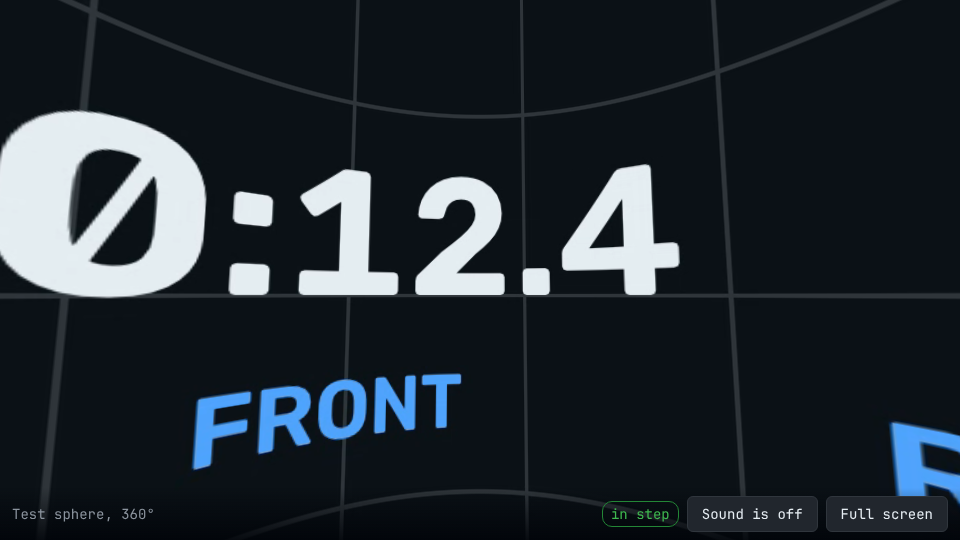
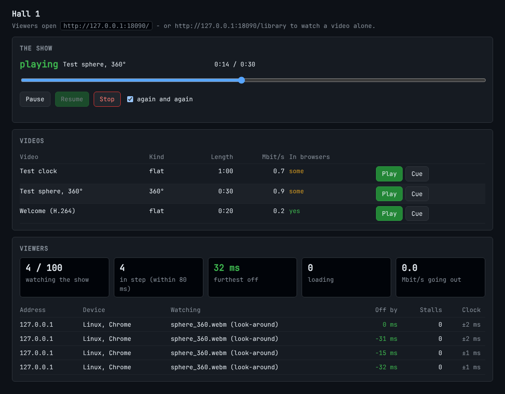

# Streaming: a video from this computer to any device

`fourdvr stream` offers videos to the devices on the venue's network — phones, tablets, computers,
televisions, the browsers of VR headsets — and keeps them **in step**: everybody who has the page
open sees the same moment of the video, and that moment can be the one the theatre's show is at.

```
                         one computer                                  the network                  any device
┌───────────────────────────────────────────────────────┐
│ fourdvr stream serve FOLDER                            │   http://SERVER:8080/          ┌─ phone, tablet, PC, TV: a browser
│   the files, as they are (byte ranges, no re-encoding) │ ─────────────────────────────► ├─ headset: its browser (VR over https)
│   one clock for all viewers                            │   /media/NAME  (no clock)      └─ any player by address: VLC, mpv …
│   operator's page · or: follows the Control Server     │
└───────────────────────────────────────────────────────┘
```

It is a part of the same program and needs nothing beyond the smallest installation (`pip install .`,
or the AppImage): the server uses Python's standard library only. Making a test video and
converting videos need the workstation packages.

**What it is for, and what not.** The VR Player keeps its own copy of each programme, checked by
checksum: for the headsets of the theatre that stays the most robust way, because nothing then
depends on the network *during* the show. Streaming is for everything else — the companion without
a headset, a wall screen in the foyer, a class with tablets, a second hall — and for headsets when
copying is not an option.

Contents: [1 Try it](#1-try-it-in-two-minutes) · [2 Will the network carry it?](#2-will-the-network-carry-it) ·
[3 The videos](#3-the-videos) · [4 The show: one clock](#4-the-show-one-clock) ·
[5 In step with the theatre](#5-in-step-with-the-theatres-show) · [6 https, VR, sensors](#6-https-vr-in-a-headsets-browser-a-phones-sensors) ·
[7 On the show PC](#7-on-the-show-pc) · [8 Tested, not tested](#8-what-was-tested-and-what-was-not) ·
[9 When something is not as expected](#9-when-something-is-not-as-expected)

## 1. Try it in two minutes

```bash
fourdvr stream test-video -o test.mp4                 # a clock, a sweeping bar, a beep on every second
fourdvr stream serve test.mp4
```

```
viewers       http://192.168.10.5:8080/
watch alone   http://192.168.10.5:8080/library
operator      http://192.168.10.5:8080/control?key=Xk3…
any player    http://192.168.10.5:8080/media/test.mp4
```

Open the *viewers* address on two devices and tap **Join**; open the *operator* address on a third
and press **Play**. Three seconds later both show the clock, in step: hold the two screens side by
side — the bar crosses the picture once a second, so the distance between the two bars is how far
apart they are (the whole width is one second).

From the Editor: *Live ▸ Stream the video to the devices on the network…* does the same for the
video that is open.

## 2. Will the network carry it?

The computer is not what limits the number of viewers. A file is sent as it is — nothing is decoded
or re-encoded — and one copy of it in memory serves everybody, so neither the processor nor the disk
is busy. Measured on a two-core 2.1 GHz virtual machine: 50 simulated viewers took a file at
12 to 15 Gbit/s together (on the machine's own loopback), and the server still answered every
other request within 10 ms.

**The limit is the network: viewers × bitrate.**

| Video | Typical bitrate | 20 viewers | 50 viewers |
|---|---|---|---|
| 1920 × 1080, flat | 5–8 Mbit/s | 100–160 Mbit/s | 250–400 Mbit/s |
| 3840 × 2160, flat or 360° | 15–25 Mbit/s | 300–500 Mbit/s | 750–1250 Mbit/s |
| 5760 × 2880 and more, 360° stereo | 40–80 Mbit/s | 800–1600 Mbit/s | 2–4 Gbit/s |

* **Cable:** a gigabit link carries about 800 Mbit/s of video. Fifty viewers of a 15 Mbit/s video
  fit; fifty of a 60 Mbit/s video do not — the server then needs a faster link to the switch, or
  the video a lower bitrate.
* **Wi-Fi is the bottleneck.** One access point shares its air time among all its clients:
  150–400 Mbit/s in all is a realistic figure for a good one in a full room, far below what its box
  says. Twenty phones on a 6 Mbit/s video are fine on one access point; fifty headsets on a
  40 Mbit/s video need several access points on separate channels (plan for 10–15 devices each) —
  or copies in the headsets.
* **Lag between viewers:** none, if they start on one clock (§4). Each device first fetches a few
  seconds ahead; a device whose network cannot keep up stalls, then jumps to where the others are.

Two tools answer the question for a particular video and a particular network:

```bash
fourdvr stream check ride.mp4 --viewers 50 --network 800      # what it asks; exit code 1 if that is too much
fourdvr stream probe http://SERVER:8080/media/ride.mp4 --viewers 50     # 50 simulated viewers, 20 seconds
```

`probe` opens that many connections and takes the video the way players do — a few seconds ahead,
then at the video's own pace — and says how many of them a real player would have stalled on.
**Run it on a computer where the viewers will be** (on their Wi-Fi), not on the server: it then
measures the network between the two. `--flat-out` takes the file as fast as it comes and shows
what the path carries at most. It cannot simulate the decoding in a real device.

## 3. The videos

`serve` takes files and folders. A folder's videos are listed by name; a `stream.toml` in the
folder gives them titles and says what they are:

```toml
[video."ride_360.mp4"]
title = "The ride"
projection = "360"          # "flat" | "180" | "360"
stereo = "ou"               # "mono" | "sbs" (side by side, left eye left) | "ou" (over-under, left eye on top)
programme_id = 7            # the theatre's programme this is the video of (§5)
# duration_s = 754.0        # only for a file whose length cannot be read (the end and the loop need it)
```

Without it, projection and stereo are guessed from the name (`360`, `180`, `vr180`, `sbs`, `lr`,
`ou`, `tb`, `mono` as words of the name) and from the picture's shape (2:1 is a full sphere, 4:1
a side-by-side sphere, a large square an over-under sphere). For a single file: `--projection`,
`--stereo`.

**What a browser plays** is decided by the device, not by this program. `fourdvr stream check`
says it for each file:

| File | In browsers |
|---|---|
| MP4 with H.264 picture and AAC sound, up to 3840 pixels wide | everywhere — the safe choice |
| the same, wider than 4096 pixels | few phones and headsets decode it: make a 3840-wide version |
| MP4 with HEVC (H.265) | Safari, and devices with a hardware decoder (most headsets); not Firefox |
| MP4 or WebM with VP9 or AV1 | current Chrome, Edge, Firefox; newer Safari |
| MKV, AVI, MPEG-TS, ProRes, anything else | not in browsers — but any player plays it from its address (below) |

```bash
fourdvr stream prepare ride.mov -o ride.mp4                     # nothing re-encoded: seconds
fourdvr stream prepare ride.mkv -o ride.mp4 --transcode --height 2160 --bitrate 18     # H.264 + AAC: slow
fourdvr stream prepare ride.mkv -o ride.mp4 --transcode --print-ffmpeg                 # the ffmpeg command instead
```

Without `--transcode` the picture and sound are copied bit for bit into an MP4 whose index is at
the front, so that playback starts at once and a jump costs one request (`check` says when a file's
index is at the end). With `--transcode` the video is re-encoded to H.264 with AAC sound; that takes
roughly as long as the video for 1080p on an ordinary PC and several times as long for 4K — the
printed `ffmpeg` command does the same and can use a graphics card's encoder if you add it.

**Any other player** — VLC, mpv, Kodi, a television's network player — plays `…/media/NAME` like a
file; it can jump in it, and any format it knows will do. Such a player is not on the clock: it
plays when its user presses play.

## 4. The show: one clock

Everybody who opens the viewers' address `/` watches the show: what the operator plays, at the
position the operator's timeline has.

**How it stays in step.** The timeline says at which instant *of the server's clock* position 0 of
the video is on the screen. Each device compares its clock with the server's — a handful of
exchanges, of which the one with the shortest round trip counts — and then steers its player: by
speed, a few per cent, when it is a little off; by a jump when it is far off. Play is announced
three seconds ahead (`--start-lead`), so every device stands ready on the first frame and starts
at the same moment. Nothing is sent in real time, so a device that has to wait for the network
falls behind and catches up by itself.

Measured with four browsers (Chromium) on one machine: each within 45 ms of the timeline — about one
frame — while playing; after pause all four on the same frame; a viewer who came in late was in
step within five seconds. Real devices add what their own video pipeline delays — tens of
milliseconds, the same on every device of one kind; sound from loudspeakers travels 3 ms a metre on
top. Side by side, two screens look simultaneous; a film's echo between two loudspeakers of
different devices may be audible — let one of them make the sound.



**The viewer's page.** *Join* is a tap because browsers start sound only after one; where a page
starts by itself (below) it plays without sound until somebody taps *Sound*. A 180° or 360° video
is drawn so that one can look around — by dragging, with the mouse wheel for the angle of view,
and by turning the phone (over https, §6); a stereo video shows one eye's picture. The pill in the
corner says *in step*, or how far off the device is.

* A wall screen or kiosk: `http://SERVER:8080/?autojoin&muted` joins by itself, without sound.
* `/library` lets a viewer pick a video and watch it alone, with play, pause and a position bar,
  also while the show runs (`--no-library` switches this off).



**The operator's page** (`/control?key=…`; the key is printed by `serve`, and can be set with
`--key`): *Play* and *Cue* (load on every screen, paused at the start) for each video, pause,
resume, a position bar, stop, *again and again* — and who is watching: how many, how many in step,
the one furthest off, how many are loading, megabits going out, and each device with its own
figures. The same from a script:

```bash
export FOURDVR_STREAM_KEY=…
fourdvr stream control play ride_360.mp4 --loop --url http://SERVER:8080
fourdvr stream control seek --position 95
fourdvr stream control pause | resume | stop | status
```

`fourdvr stream serve film.mp4 --play --loop` starts the show at once: a server for a foyer screen
needs no operator.

More viewers than `--max-viewers` (default 100) are refused with a message, so that a full room does
not spoil the picture for everybody.

## 5. In step with the theatre's show

```bash
fourdvr stream serve /srv/programmes --follow http://192.168.10.2:8080 \
        --user stream --password-file /etc/fourdvr-motion/stream.password
```

With `--follow` the timeline is not an operator's but the **Control Server's**: when the theatre
plays programme 7, the stream plays programme 7's video at the same position — a phone or a wall
screen runs in step with the headsets and the platforms; PAUSE, RESUME, STOP and the black screen
are followed too. The Control Server is not changed for this, and nothing is installed on it: the
stream server signs in like a person with the lowest role and looks at the show's state four times
a second (PLAY is announced by the Control Server three seconds before it happens, which is why
that is early enough).

1. On the Control Server, make an account with the role **viewer** and put its password into a
   file only the service can read:

   ```bash
   # on the Control Server's computer (with its own configuration file):
   printf '%s\n' 'a-long-password' | fourdvr-server -c server.toml user add stream --role VIEWER --password-stdin
   # on the stream server's computer:
   printf '%s\n' 'a-long-password' | sudo tee /etc/fourdvr-motion/stream.password >/dev/null
   sudo chown fourdvr-motion: /etc/fourdvr-motion/stream.password && sudo chmod 600 /etc/fourdvr-motion/stream.password
   ```
2. The programme's video must be among the served files. It is found by the `programme_id` in
   `stream.toml`, else by the checksum the Control Server has for the programme's video, else by
   the file's name. What kind of video it is (flat, 180°, 360°, stereo) is taken from the programme.
3. A programme whose video is not there is not played; the viewers' page and the status line say
   which file is missing.

If the Control Server does not answer for ten seconds, the stream stops — as the platforms do.
The stream's own operator page shows the viewers but cannot interfere with the theatre's show.

Measured with the Control Server 1.0.0, a show service with a simulated platform and two browsers:
the stream's timeline within 2 ms of the Control Server's; the browsers within 30 ms of the Control
Server's position; after PAUSE on the same frame.

## 6. https, VR in a headset's browser, a phone's sensors

Watching needs nothing but plain `http`. Two things browsers give only to pages that came over
**https**: the VR mode of a headset's browser (WebXR — the page then shows a *VR* button, and draws
the video for both eyes, each with its half of a stereo frame), and a phone's motion sensors (look
around by turning the phone). For those:

```bash
fourdvr stream cert -o /etc/fourdvr-motion/stream                # a certificate of your own (needs the openssl program)
fourdvr stream serve … --cert /etc/fourdvr-motion/stream/stream.crt --cert-key /etc/fourdvr-motion/stream/stream.key
```

A certificate one has made oneself is unknown to browsers: each device says so once and lets its
user go on (*Advanced ▸ Proceed*). A venue with its own certificate authority or a real domain name
can use a certificate from there instead. Encrypting costs little: the machine of §2 sent 4.6 Gbit/s
to fifty viewers over https, against 12 to 15 without — both far more than a network carries.

## 7. On the show PC

The stream server runs beside the show service (it is a process of its own; the platforms'
control loop is never involved) or on any other computer of the network that has the videos.

```bash
sudo install -d -m 0755 /srv/programmes                         # the videos, and stream.toml
sudo install -m 0644 deploy/systemd/fourdvr-stream.service /etc/systemd/system/
sudoedit /etc/systemd/system/fourdvr-stream.service             # the folder, the port, --follow or not
sudo systemctl daemon-reload && sudo systemctl enable --now fourdvr-stream
sudo journalctl -u fourdvr-stream -f                            # the addresses, then a line whenever something happens
```

Open the server's TCP port (8080) for the viewers' network. The server has no user accounts: keep
it on the venue's own network, and treat the operator's key like a password (set a lasting one with
`--key` or the environment variable `FOURDVR_STREAM_KEY`; without it a new one is made at every
start).

## 8. What was tested, and what was not

**Tested** (automated: `tests/stream`, and `integration/run_stream_integration.py` with a real
server process, real browsers and the real Control Server):

* byte ranges, fifty requests at once, the pages, the key, the viewer limit, https with a
  certificate made by `cert`;
* the timeline: play with its lead, pause, resume, seek, loop, the end of a video; following a
  Control Server (a stand-in for every state, and the real one end to end);
* fifty simulated viewers of one server: all served, the server answering others meanwhile;
* four browsers (headless Chromium): start together, in step within 45 ms, same frame after pause,
  jumps, a late viewer, a looped 360° video across its turn, looking around by dragging, the
  operator's page, watching alone;
* reading MP4 files without decoding, `prepare` (copies are bit-identical; re-encoding gives
  H.264 + AAC), the test video.

**Not tested — none of it exists in the test environment:**

* **any real phone, tablet, television or headset**, and any browser but Chromium (Safari and
  Firefox follow the same standards; their video pipelines differ);
* **VR mode (WebXR) in a headset's browser** and **look-around by a phone's sensors**: the
  mathematics is tested, the devices are not;
* a real network: Wi-Fi with a room full of devices is where streaming succeeds or fails — measure
  yours with `fourdvr stream probe` before the visitors do;
* H.264 playback in a browser (the test browser has only the open codecs; the test videos use VP8
  and VP9).

## 9. When something is not as expected

| What you see | What it means |
|---|---|
| a device shows *Waiting for the show* | nothing is playing — or, with `--follow`, the note under it says why (the Control Server does not answer, a programme's video is missing) |
| *This device cannot play this video* | its browser lacks the codec: `fourdvr stream check`, then `prepare --transcode` |
| picture but no sound, *Sound is off* | the page started by itself, or the browser wants a tap: tap *Sound* |
| *loading* again and again on some devices | their network does not carry the bitrate: `fourdvr stream probe` from where they are; fewer devices per access point, or a lower bitrate |
| a device is steadily *N ms behind* | a slow decoder (a 4K video on an old phone): a smaller version of the video |
| the start takes long, jumps take long | the file's index is at its end: `fourdvr stream prepare` |
| no *VR* button in a headset's browser, no look-around by turning the phone | the page came over plain http: §6 |
| a 360° video is shown flat, or the other way round | `projection` / `stereo` in `stream.toml` (or `--projection`, `--stereo`) |
| *the server does not let this device in* | `--max-viewers` is reached |
| the operator's buttons are grey | the stream follows the theatre's show: it is controlled at the Control Server |
| `cannot listen on …` | another program has the port: `--port` |
