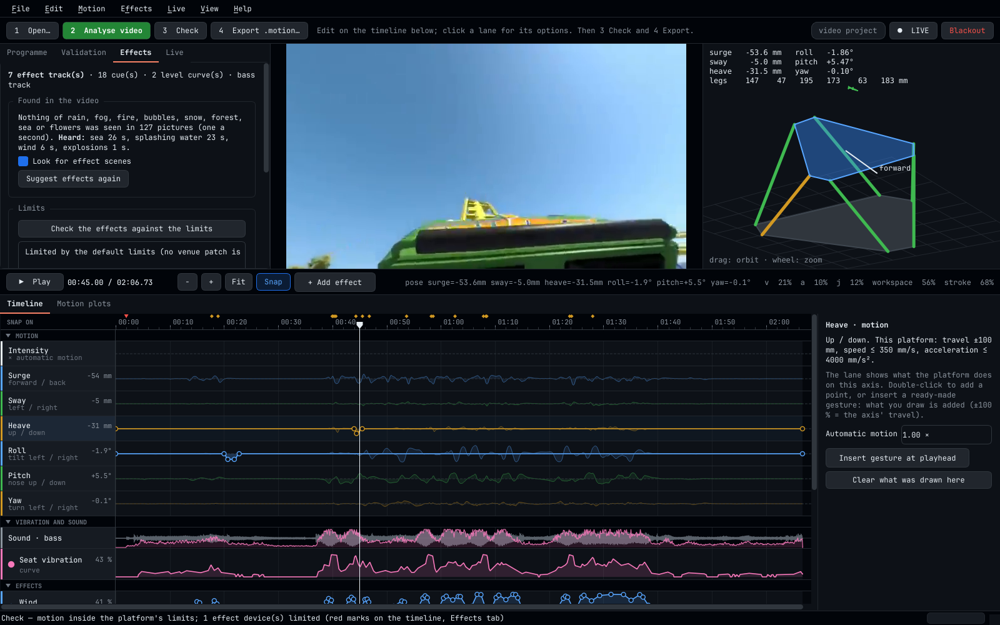
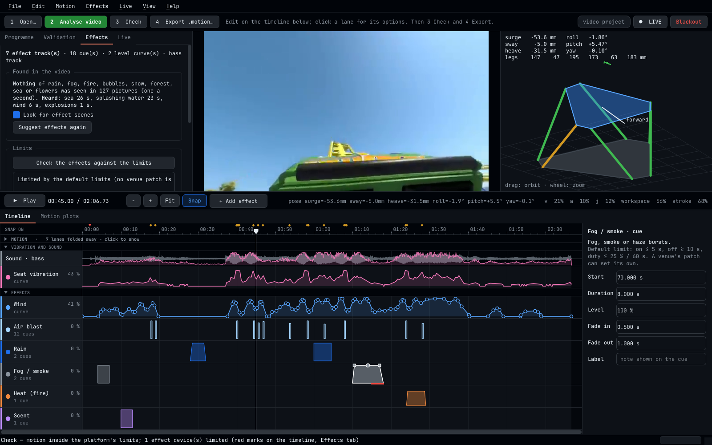
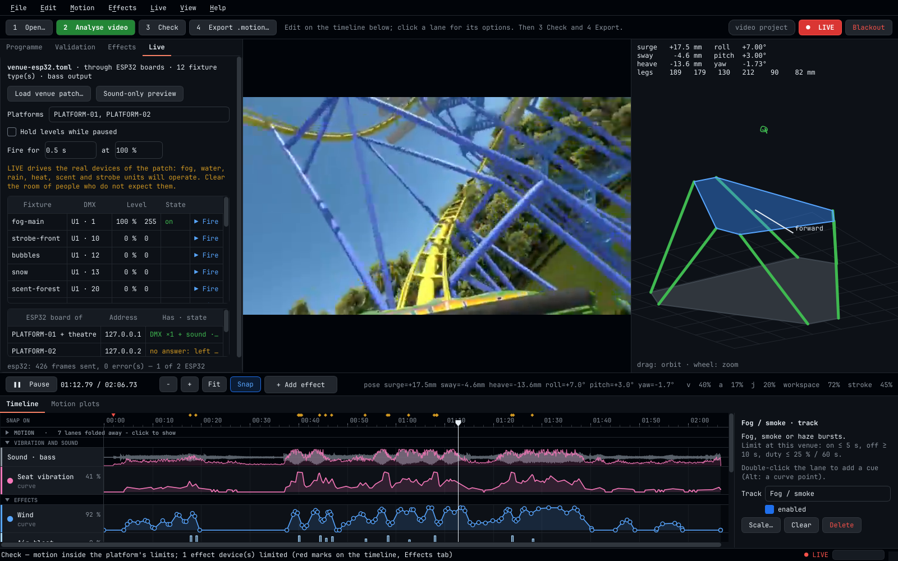

# The Editor — user guide

Start it with `fourdvr` (or double-click the AppImage). `fourdvr ride.mp4`, `fourdvr ride.4dvr` and
`fourdvr ride.motion` open a video, a saved project or an existing motion file directly.



```
┌ File  Edit  Motion  Effects  Live  View  Help ─────────────────────────────────────────────────┐
│ 1 Open…  2 Analyse video  3 Check  4 Export .motion…   what to do next …        ● LIVE  Blackout │
├───────────────┬───────────────────────────────────────┬────────────────────────────────────────┤
│ Programme     │                                       │                                        │
│ Validation    │              video                    │        3D platform preview             │
│ Effects       │                                       │                                        │
│ Live          │                                       │                                        │
├───────────────┴───────────────────────────────────────┴────────────────────────────────────────┤
│ ▶ Play   00:45.00 / 02:06.73   − + Fit  Snap  + Add effect        pose … v a j workspace stroke │
│ Timeline │ Motion plots                                                       ┌────────────────┤
│ ▾ MOTION               intensity · surge · sway · heave · roll · pitch · yaw  │  options of    │
│ ▾ VIBRATION AND SOUND  sound and bass · seat vibration                        │  the lane, cue │
│ ▾ EFFECTS              wind · rain · fog · heat · bubbles · snow · water ·    │  or point that │
│                        air · scent · strobe · DMX · …                         │  was clicked   │
└───────────────────────────────────────────────────────────────────────────────┴────────────────┘
```

A programme is made with the four numbered buttons, from left to right. The line next to them says
what comes next.

| Button | What it does |
|---|---|
| **1 Open…** | a video to make a programme from, a saved project (`.4dvr`), or a finished `.motion` file whose effects you want to change |
| **2 Analyse video** | works out the motion, the vibration and bass, and a draft of the effects — everything the video can tell |
| **3 Check** | the motion against the platform's limits, the effects against the venue's limits |
| **4 Export .motion…** | writes the one file the theatre plays |

Between 2 and 3 you edit on the timeline as much or as little as you like. A video that has only
been analysed is already a complete programme.

Work is saved as a **project** (`File ▸ Save project`, `.4dvr`): settings, the analysis, what was
found in the video, the manual motion and the effects. The project refers to the video by path and
checksum; keep them together (a project next to its video still opens after the folder was moved).
`Ctrl+Z` / `Ctrl+Shift+Z` undo and redo every change to manual motion and effects.

## 1 · Open

**1 Open…** (`Ctrl+O`) — choose the programme video (MP4, MOV, MKV, OGV, AVI, …). The Editor reads
its size, frame rate and duration and computes the SHA-256 of the file. That checksum goes into the
`.motion` file; the Control Server uses it to check that motion and video belong together, so
always work from the **final** video file — a re-encoded file is a different file.

The VR format is *guessed* from the aspect ratio (2:1 → 360 mono, 4:1 → 360 side-by-side, …,
anything else → flat). **Confirm projection and stereo layout** in the *Programme* tab before the
analysis; they must match what the programme is set to on the server.

## 2 · Analyse video

One click, and the Editor does on this computer, without any network:

| Stage | What happens |
|---|---|
| picture | The video is decoded once. Image features are tracked from frame to frame, scene cuts are found, the camera's rotation and translation are estimated for every frame, and the picture brightness is measured |
| scenes | Once a second a picture is shown to the picture model, which scores it for rain, fog or smoke, fire, bubbles / underwater, snow, forest, sea, flowers and splashing water; afterwards the sound model listens to the sound track for rain, thunder, fire, explosions, splashing, sea, bubbling and wind ([SCENE_DETECTION.md](SCENE_DETECTION.md)) |
| sound | The sound track is read: waveform, the bass track for subwoofers and shakers |
| motion | Camera motion becomes perceptual cues — turns, banking, acceleration, vibration, impacts — with washout and tilt coordination ([MOTION_ALGORITHM.md](MOTION_ALGORITHM.md)). Then the platform profile is applied: smoothing to the platform's bandwidth and local reduction wherever position, velocity, acceleration, jerk or an actuator limit would be exceeded. Timing is kept; only intensity is reduced where necessary |
| effects | Every effect lane that is still empty gets a draft (table in [Effects](#effects)) |
| validation | Every limit of the profile is checked; the *Validation* tab lists value, limit and OK / VIOLATION per quantity |

On the two-core machine this was tested on, a 127-second 360° video took about four minutes (of
which looking for scenes was half a minute); a
desktop PC with more processor cores is faster. A video without sound is
fine: the sound-based parts are left out.

Pressing **2 Analyse video** again later (a new cut of the video is a new file and a new project;
this is for changed projection settings) repeats everything **except** what you have made: a lane
you have put something on is kept as it is, only empty lanes are drafted again. One `Ctrl+Z`
takes a draft back.

The *Effects* tab shows under **Found in the video** what was seen and heard, in seconds, and has
the switch **Look for effect scenes** (also in the Effects menu). Switched off, the analysis is a
little faster and drafts only what the camera motion and the sound level give: wind, vibration,
air blasts and strobe.

### Programme tab

| Field | Meaning |
|---|---|
| Programme ID | the programme number on the Control Server (PLAY 1 = id 1); written into the file |
| Projection, Stereo layout | `flat` / `180` / `360`; `mono` / `sbs` / `ou`. Only the left eye is analysed |
| Flat video HFOV | horizontal field of view of flat video (75° ≈ a normal camera; action cameras 100–120°) |
| Motion rate (Hz) | sample rate of the motion (50–200, default 100) |
| Analysis width (px) | frames are scaled to this width for tracking (640; larger is slower, rarely better) |
| Platform profile… | the profile `.toml` of your platforms (from the motion technician; the same file the show service uses). The bundled one is an example |
| Global gain, axis gains, Rotation gain | intensity |
| Peak specific force, tilt coordination, Max tilt, Washout high-pass | how sustained accelerations are rendered |
| Vibration gain, Impact gain | strength of the vibration texture and of bumps |
| Fade in/out | motion (automatic and manual) fades in at the start and out at the end |

Projection, stereo layout, field of view and analysis width take effect with the next analysis.
Every other number changes the motion at once: half a second after you stop typing, the motion is
generated and limited again and the lanes show the result (programmes longer than ten minutes:
`Ctrl+R`, *Motion ▸ Update the motion now*).

### Preview

**Play** (Space) runs video, 3D platform, plots and timeline together; the programme loops as it
does in the theatre. The 3D view shows the platform in its pose with the six actuators coloured by
how close they are to their stroke ends; the line right of the transport shows the pose and the
current use of the velocity, acceleration, jerk, workspace and stroke limits. *Motion plots* (the
second tab at the bottom) show translation, rotation and limit use over the whole programme, with
the motion classes as coloured bands.

| Content | Suggestion |
|---|---|
| Roller coaster, rides, racing | defaults; reduce Global gain if the preview shows frequent limiting |
| Flight, drone | tilt coordination on; Rotation gain 0.6–0.8; vibration low |
| Walking / handheld documentary | strongly attenuated by design — motion will be subtle; consider motion by hand |
| Many cuts | motion fades across cuts; nothing is synthesised across an edit |
| Static camera | no automatic cues; draw the motion by hand (below) |

## The timeline

Everything a programme does is on one timeline, in three groups. A click on a group's heading
(or `M` for the motion lanes, `E` for the effect lanes) folds the group away and shows it again —
fold the motion lanes to see more effect lanes, and the other way round.

**Click a lane** and its options appear to the right of the timeline: what the lane is, the limit
that applies to it, and what can be set. Click a cue or a curve point and the same place shows
its exact numbers.

### Motion

Seven lanes: **Intensity** and one for each axis — surge (forward / back), sway (left / right),
heave (up / down), roll (tilt left / right), pitch (nose up / down), yaw (turn left / right).

Each axis lane shows, as a faint trace, **what the platform does on that axis**; the full height
of the lane is the axis' travel in the platform profile, and the number in the lane's heading is
the position at the playhead. What you draw on the lane is **added** to it: ±100 % is the full
travel of the axis.

* Double-click a lane to add a point; drag points; curves ease between points, so the platform
  starts and stops gently.
* **Insert gesture at playhead** (lane options, Motion menu, or right-click on a lane) places a
  ready-made shape: jolt, drop, lift and hold, bank left / right, nose up / down, launch, brake,
  swerve, turn, gentle shake. Gestures are sized so that a typical electric platform can follow
  them almost unchanged; drag their points to shape them.
* **Automatic motion** in the lane options is how strongly the motion from the video moves this
  axis: 1 = as analysed, 0 = not at all (the axis then carries only what you draw), up to 3. It
  is the same number as the axis gain on the *Programme* tab.
* Directions: surge + forward, sway + left, heave + up, roll + right side down, pitch + nose down,
  yaw + nose left.

**Intensity** scales the automatic motion over time: 100 % is unchanged, 0 % rests the platform
for a passage (titles, a calm scene, a moment when visitors should concentrate on something
else), up to 200 % emphasises one. Its option *Automatic motion, all axes* is the global gain.

Whatever is drawn is applied *before* the platform's limits, so it passes the same limits and the
same validation as the automatic motion. Shortly after each change the motion is processed again
by itself; until then the traces are drawn dashed.

**Motion ▸ Automatic motion from the video** switched off gives a programme with hand-made motion
only — for footage the analysis cannot read, or a deliberately choreographed ride.

Fast vibration is not for the platform — use the *Seat vibration* lane (bass shakers).

### Vibration and sound

**Sound · bass** shows the video's sound (grey) and its bass (pink). Its options are the bass
track: the low end of the sound (low-pass at 120 Hz by default, mono, 2 kHz) is put into the
`.motion` file and played at the venue through subwoofers or bass shakers, locked to the same
timeline as the motion — independent of the headsets' own audio. A 5.1 file's LFE channel is used
as well. *Bass from another file…* takes it from a separate mix (WAV, FLAC, MP3, a video). Untick
*Bass track in the file* for a programme without it. A two-minute programme adds about half a
megabyte to the file.

**Seat vibration** is a level curve for a synthesised rumble on the same shakers, drafted from
camera shake and the low-frequency energy of the sound. Double-click to add points; *Scale…* in
the lane options makes the whole lane stronger or weaker.

### Effects

One lane per effect. **+ Add effect** (above the timeline, or the Effects menu) adds a lane:

| Type | Double-click adds | Notes |
|---|---|---|
| Wind | a curve point | continuous level; fans need time — the venue patch sends it early |
| Water spray | a cue (0.4 s) | keep bursts short |
| Rain | a cue (4 s) | overhead drops for as long as it rains in the picture |
| Air blast | a cue (0.25 s) | |
| Fog / smoke | a cue (3 s) | fog needs seconds to arrive and minutes to clear |
| Heat (fire) | a cue (3 s) | warm air or a heat lamp for fire scenes |
| Bubbles | a cue (5 s) | |
| Snow | a cue (5 s) | |
| Strobe / lightning | a cue (1 s) with a flash rate | flashes start at the start of the cue; a 0.15 s cue is one flash. The venue caps the rate (3 per second unless assessed otherwise). The lane's option sets the rate of new cues |
| Scent | a cue (4 s) with a cartridge number | one lane per scent is easiest: set the cartridge in the lane's options |
| Seat vibration | a curve point | appears under *Vibration and sound* |
| DMX channel | a curve point | a raw channel (universe, channel in the lane's options): house lights, anything unpatched. No limit is applied to it |
| Other effect type… | a cue | any name the venue patches |

Hold **Alt** while double-clicking to add the other kind (a curve point on a cue lane, a cue on a
curve lane). A lane outputs the larger of its curve and its cues; with several lanes of one type
the largest wins.

**What the analysis drafts.** It writes to the first lane of each type and only if that lane is
empty. *Effects ▸ Suggest effects from the video again* (or the button in the *Effects* tab)
drafts all of them anew and asks before it replaces anything.

| Lane | From | Draft |
|---|---|---|
| wind | the camera's forward speed in ride, vehicle and flight passages | a level curve |
| vibration | camera shake and the low-frequency energy of the sound | a level curve |
| air | impact-like motion events | one blast each |
| strobe | where the picture flashes briefly (lightning, explosions) | a cue with 3 flashes a second |
| rain | rain seen for at least 2 s (or half-seen and clearly heard) | a cue for as long as it rains, at 60 to 100 %: the more rain is heard, the stronger (70 % for a video without sound) |
| fog | fog, mist or smoke seen for at least 3 s | a 3 s burst when the scene starts, again every 20 s |
| heat | fire seen for at least 1 s (or half-seen while fire or an explosion is heard) | a cue for as long as the fire |
| bubbles | bubbles or an underwater scene seen for at least 3 s | a cue for the scene, at 80 % |
| snow | falling snow or a snow landscape seen for at least 3 s | a cue for the scene, at 70 % |
| water | splashing water seen for at least 1 s (and, if the video has sound, heard) | a 0.5 s burst, again every 4 s while it lasts |
| scent | forest, sea or flowers seen for at least 5 s | one 3 s burst when the scene begins, with cartridge 1 (forest), 2 (sea) or 3 (flowers); the same scent not again within 90 s |

Scene ends are moved onto a scene cut if one is within 0.6 s. Treat the draft as a first
suggestion — delete what does not fit, and add what the models missed.

### Editing on the timeline

| Do | How |
|---|---|
| move the playhead | click or drag in the ruler; click on empty lane space; ← → (one frame, Shift: ten) |
| see a lane's options | click the lane or its heading |
| add | double-click a lane (Alt: the other kind); right-click for a menu |
| move a cue | drag it; several selected cues move together |
| lengthen / shorten | drag the left or right edge |
| level of a cue | drag the dot at the top centre of a selected cue, or ↑ ↓ |
| fade in / out | drag the squares at the top corners of a selected cue |
| move a curve point | drag (Shift: only up/down or only sideways) |
| select several | drag a rectangle over empty space; Ctrl+click adds or removes |
| copy / cut / paste / duplicate | Ctrl+C / X / V (at the playhead) / D |
| delete | Del |
| nudge | ← → (Shift: coarse) |
| switch an effect lane off | the dot left of its name |
| make a whole effect lane stronger or weaker | *Scale…* in the lane's options |
| fold a group away | click its heading; `M` motion lanes, `E` effect lanes |
| zoom | Ctrl+wheel, `+` `−`, **Fit** (`F`); Shift+wheel scrolls along time |
| snapping | cues and points snap to the playhead, to other cues, to scene cuts (red marks in the ruler) and impacts (orange marks), and to whole video frames when zoomed in. **Snap** (`S`) switches it; hold Alt to move freely |

The cue's shape on the lane is what is sent: height = level, sloped ends = fades. With several
cues selected, level, fades and the parameter apply to all of them.



## 3 · Check

**3 Check** does two things and says the result in the status line.

**Motion against the platform's limits.** The *Validation* tab lists every quantity with its
value and limit. PASSED means "numerically inside the configured limits" — not "safe for
passengers" (README.md).

**Effects against the limits of the devices.** Every device may be on only so long, needs a pause
afterwards, and may run only so much in a show; a strobe may flash only so fast. The check plays
the programme through these limits on paper and marks in **red under a cue** the part that a limit
will cut. The *Effects* tab lists it under **Limits**.

* Without a venue patch the **default limits** are used — the ones a device gets when its venue
  sets nothing else (table in [EFFECTS_GUIDE.md](EFFECTS_GUIDE.md)).
* With the theatre's patch loaded (*Live* tab ▸ **Load venue patch…**) the check uses that
  venue's own limits and devices, and also says which effect types have no device there.

The check also runs by itself a moment after every edit. Nothing has to be "fixed" — the show
runs either way, and the limits are applied at playback whatever the file asks for — but a cue
that is cut is a cue the audience does not get.

## Live: try it on the devices



*Live* tab ▸ **Load venue patch…** — the theatre's patch file ([EFFECTS_GUIDE.md](EFFECTS_GUIDE.md)).
**● LIVE** (`Ctrl+L`) then connects the Editor to the devices of the patch. It uses the same
engine as the show service — the same lead times, the same limits — so what you see is what the
theatre will do.

* While **playing**, effects are output in step with the picture; while paused, everything is off.
* **Hold levels while paused** keeps the levels under the playhead on the devices — to set a
  fan speed or a light level by eye. Limits still apply. A strobe that this software flashes gives
  one flash where the playhead stands, and however fast the playhead is dragged, its flashes stay
  as far apart as the venue's ceiling demands.
* **▶ Fire** (a click in the fixture's row, *Live* tab) switches one device on for the time and level set above the
  table — the quickest way to find out what is where.
* The table shows every fixture's level, DMX values and whether a limit is holding it off.
* With a patch whose output is **ESP32 boards**, a second table lists the boards: which platform
  (or the theatre's devices) each serves, its address, what it has (a DMX line, a sound output)
  and whether it answers. A board that does not answer is left out; the rest plays. The Editor
  knows no motion links, so list every board's address in the patch (`[output.esp32.platforms]`).
* **Blackout** (`Ctrl+B`) stops playback and switches everything off at once.
* Edits made while live take effect immediately.

Without a venue patch, LIVE is a **sound-only preview**: the bass track and the seat vibration
play on this computer's sound output (use headphones or a subwoofer — laptop speakers do not
reproduce 45 Hz), and no DMX is sent.

LIVE drives real devices. Clear the room of people who do not expect fog, water, heat, scent or
flashing light; the Editor asks before it goes live on a network, USB or ESP32 output.

No devices on your desk? Run `fourdvr fx monitor` in a terminal on any PC of the effects network
(it prints the DMX that arrives), or `fourdvr controller esp32-sim` for a simulated ESP32 board.

## 4 · Export

**4 Export .motion…** (`Ctrl+E`) validates (if needed) and writes one file: the motion and, in its
header, the effects and the bass track. Upload the video **and** this file to the programme on the
Control Server, validate and publish there — the same procedure as before. The status line names
what the file contains ("motion only", or the number of effect tracks and the bass track).

`File ▸ Export effects (.fx.json)…` writes the effects alone, `Import effects…` reads them from a
`.fx.json` or from another `.motion` file — to reuse a set of cues, or to hand the effects to
someone else.

## Changing the effects of an existing motion file

**1 Open…** a `.motion` file that was made earlier (any version). Its motion is shown on six
lanes but cannot be changed; effect lanes can be added, edited, checked and tested as above.
`File ▸ Attach video for preview…` adds the picture and the waveform (scenes are only looked for
when a video itself is opened and analysed). **4 Export** writes a new file with bit-identical
motion; exporting with all effects removed gives back the original file, byte for byte. Upload
the new file to the Control Server in place of the old one.

## Comfort and care

Effects are stronger in a headset than on a screen: the visitor cannot see them coming. Use fewer
and shorter effects than seems right at the desk, leave pauses, and try the programme with
colleagues before the public. Water, rain and scent in particular are remembered longer than they
last. The safety notes in README.md apply to every effect.
