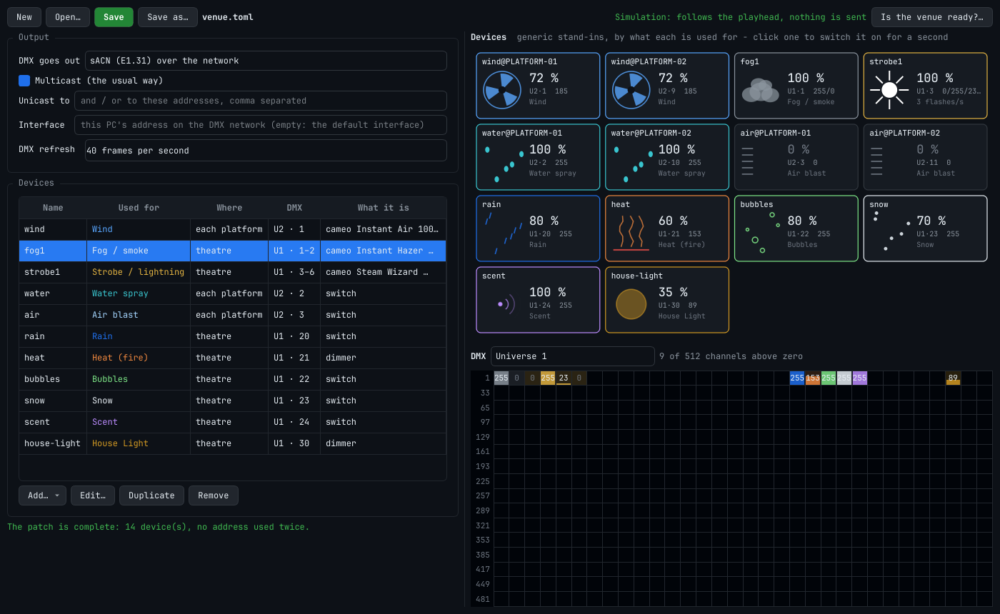
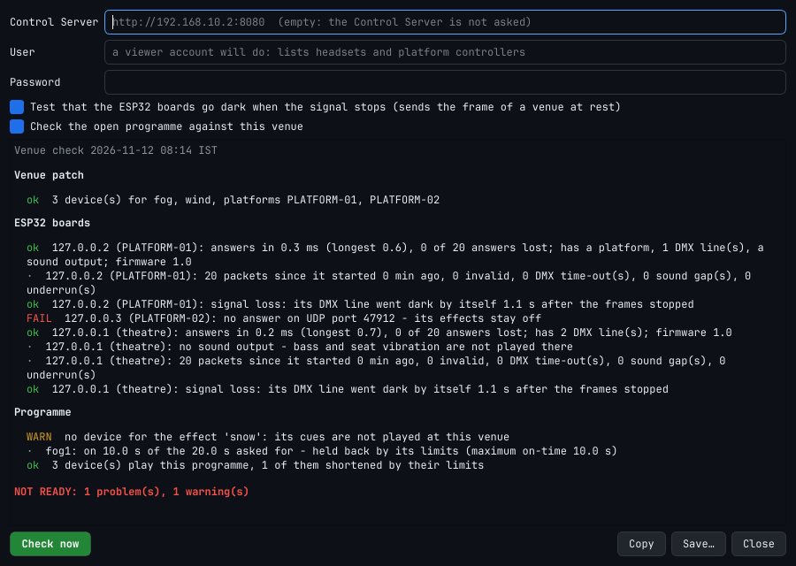

# The venue: patch, devices, DMX, and "is it ready?"

New in 3.2. Three things that were done in a text editor and on the command line now also have a
window, and one thing is new altogether:

| | In the Editor | On the command line |
|---|---|---|
| Make and change the **venue patch** | *Live ▸ Venue…* (Ctrl+Shift+D) | a text editor; `fourdvr fx fixtures entry … --patch` |
| Take a **real device** from a library instead of typing its channels | *Add… ▸ A device from the fixture library* | `fourdvr fx fixtures search / show / entry` |
| See the **devices and the DMX** with the film, without hardware | the right half of the window | `fourdvr fx monitor` (DMX that arrives on a PC) |
| **Is the venue ready?** | the button of that name | `fourdvr fx ready` |

Nothing changes for a venue that keeps its patch as it is: the file format only gained three
optional keys (§3.4), and the show service plays a patch exactly as before.



## 1. The window

**Live ▸ Venue…** (or the *Venue…* button on the Live tab) opens it beside the Editor. It starts
with the patch the Editor has loaded, or with an empty one.

### 1.1 Output

*DMX goes out* chooses how: not at all (the patch is only checked and simulated), sACN, Art-Net, a
USB DMX interface, or through the ESP32 boards. Only what you set is written to the file; every
other key keeps its default, and what the file already said for another kind of output is kept.

**Through the ESP32 boards.** The table lists the Editor's platforms (Live tab, *Platforms*); each
gets the address of its board. *Find boards on the network* asks every board on this network
segment what it has (the same question as `fourdvr fx nodes --find`) and lists those that answer:
double-click one to give it to the platform selected in the table - or, with no platform selected,
to the theatre's devices. A board in another segment is not reached by that question: type its
address. The theatre's devices are either on a board of their own, or on the DMX line of one
platform's board.

Finding boards changes nothing on them. A board's own settings - its network address, pins, what
is wired to it - are in its firmware (`firmware/esp32-actuator-bridge/include/config.h`).

### 1.2 Devices

One row per device type of the venue. **Add… ▸ A device from the fixture library** (§3) or
**A generic device**: a dimmer (one channel, 0 to 100 %), a switch (a relay), or level and flash
rate (two channels). A new device is put on the first free address of its universe.

**Edit…** (or a double-click) opens everything about one device:

| | |
|---|---|
| Name (id) | how the device is called everywhere: in the check, on the tiles, in `fx fire` |
| Used for | the effect type whose lane on the timeline drives it; any name will do |
| How many | one for the theatre, or one on every platform (then *Step per platform* is how much higher the address of the next platform's device is on a shared DMX line; through ESP32 boards every platform has a line of its own and the step stays 0) |
| Send earlier by | the time the device needs to be felt: a fan spinning up, fog arriving |
| Strobe | whether the device flashes itself (a rate channel) or we switch its level |
| Only cues with | e.g. `slot=2`: a scent dispenser's second cartridge |
| Channels | for each DMX channel of the device: *level* follows the effect (Off / Min / Max), *switch* is On or Off, *rate* is a strobe's flash rate, *static* keeps a Value - while the effect is on, or always |
| Limits | what the venue allows this device: empty fields keep the default of its effect type, shown in grey (docs/EFFECTS_GUIDE.md §5) |

The line under the table says at once what is wrong - an address used twice, a channel beyond 512,
a strobe that cannot keep to its limit - and what a person should have read (the warnings of
`fourdvr fx check-patch`). A patch with errors cannot be saved.

**Save** writes the file and makes it the Editor's venue patch: the limits check on the timeline
and LIVE use it from then on. The file is written as a person would write it, one block per
device. **Comments of a hand-written file are not kept** when the window writes it again; to keep
them, add devices with `fourdvr fx fixtures entry … --patch` (which appends) or by hand.

## 2. Devices and DMX, with the film

The right half shows what the patch does with the open programme.

* **Devices:** one tile per device - per platform for platform devices - drawn as a generic
  stand-in for what it is used for: a fan turns faster with the level, fog thickens, a strobe
  flashes at the rate it is sent, drops fall, a heater glows; anything else is a lamp that is
  more or less on. Each tile shows the level, the DMX address and the values sent, and in red
  what holds a device back ("held: cool-down"). **These are stand-ins, not models of your
  devices:** a real fan needs seconds to spin up and a real fog machine minutes to clear; the
  tiles show what is sent, not what the room feels.
* **DMX:** the 512 channels of one universe, each with its value as a bar and a number, the
  channels of a device in the colour of its effect. Point at a cell for its device and what the
  channel is. Through ESP32 boards a "universe" is a board's DMX line, and is called that.

Both follow the playhead - while playing, and also while paused: the levels under the playhead
are held, as with *Hold levels while paused* on the Live tab, and a device that is held on for
longer than its limit allows is cut off here as it would be in the room.

**Simulation** (the green line at the top) is the default: the patch as it stands in the window,
saved or not, is played by the same effects service that runs the show - the same limits, lead
times and software flashes - into nothing. No DMX leaves the PC and no sound is played. Click a
tile to switch that device on for a second, in the simulation.

**LIVE** (red): while the Editor is live, the same tiles and channels show what goes to the real
devices of the Editor's patch. Real devices are fired from the Live tab, not from the tiles.

## 3. The fixture library

A patch entry says what every DMX channel of a device gets. For a real device this used to mean
reading its manual. The library knows it: **653 devices of 138 makers with 2 904 DMX modes**, from
the [Open Fixture Library](https://open-fixture-library.org) (MIT licence;
`THIRD_PARTY_LICENSES.md`), as of 11 November 2026 - inside the package, no network needed.

Most of it is stage lighting. What a 4D theatre uses is there too: 33 fog machines and hazers,
five fans, 66 strobes, 114 dimmers and dimmer packs, and any LED light as lightning or as a glow.

### 3.1 From a device to a patch entry

```bash
fourdvr fx fixtures search hazer                       # by words of the maker and the name
fourdvr fx fixtures search --category Fan              # or a whole category; without anything: the categories
fourdvr fx fixtures show cameo/instant-hazer-1500-t-pro --effect fog
fourdvr fx fixtures entry cameo/instant-hazer-1500-t-pro --effect fog --patch venue.toml
```

`show … --effect` prints the device's channels and what each would get:

```text
cameo Instant Hazer 1500 T Pro   [cameo/instant-hazer-1500-t-pro]   Hazer   from: Open Fixture Library
modes: 2ch (2 ch)
mode 2ch as a fog device:
    1  Haze                     0–5 NoFunction, 6–255 Fog (weak … strong)
       -> driven by the effect: off 0, 6 … 255
    2  Fan                      0–255 Speed (slow … fast)
       -> 0
note: left at 0: Fan - give it a value in the patch if the device needs one there (the fan of a hazer, a second dimmer)
```

`entry` prints the `[[fixtures]]` block (redirect it, or pipe it through `tee -a venue.toml`), or
with `--patch` appends it to a patch file: at the first free address of the universe unless
`--address` is given, with a name of its own unless `--id` is given - and only if the patch still
loads with it; otherwise the file is left as it was. Appending keeps the file's comments.

In the window, *Add… ▸ A device from the fixture library* is the same: search, choose the mode the
device itself is set to, say what it is used for, and read what each channel gets before pressing
OK.

### 3.2 What is decided for you, and how

| | |
|---|---|
| **What the effect drives** | for *fog*: the device's fog output; for *wind*: its speed or rotation; for anything else: its dimmer. Failing that, the next best of those; a light without a dimmer is driven by its colour channels together. The value range is the one the library gives ("6–255"), with "off" where the device does nothing. A range that runs the other way (255 = slow) is turned round. |
| **Colours and shutter** | when the device is used as a light: every colour channel full and the shutter open while the effect is on, dark otherwise. A fog machine's lamps stay dark. |
| **Other channels** | the value the library names as the device's resting value, else 0. A 16-bit channel's fine half is 0. Channels of the kind an effect could drive that are left at 0 are named in a note (the fan of a hazer): give them a value in the device's *Channels* if the device needs one. |
| **A pack of outputs** (dimmer pack, relay pack) | one entry is one output: `--output 3` (in the window: *Output of a pack*). The other outputs stay free for other devices, at the same start address. |
| **A strobe** | flashes itself only if the library says, in flashes per second, that it can be as slow as the venue's limit (3 a second unless `--max-rate` says the venue has assessed a higher one). Otherwise we switch its dimmer (`flash = "software"`), which keeps to the limit by construction. A strobe whose rates are not known and that has nothing we could switch is **refused**: measure it and write its channels by hand. |

Always read the result. The library describes devices; whether *your* device is in the mode you
chose, and whether a fog machine should get 100 %, it cannot know. `fourdvr fx check-patch` prints
the address table, and the window's simulation shows the values with the film.

Not read: modes that repeat channels for every pixel of a pixel bar or matrix (728 of the 2 904
modes), modes of more than 32 channels (37) - neither is an effect device - and six modes whose
file names a channel it does not describe. They are listed with the reason; the other 2 133 can be
patched.

### 3.3 A device that is not in the library

Describe it with the library's own [Fixture Editor](https://open-fixture-library.org/fixture-editor)
(a web page), download it as "Open Fixture Library JSON", and:

```bash
fourdvr fx fixtures library --add my-fan.json      # copies it to ~/.local/share/extended-4d-editor/fixtures
fourdvr fx fixtures library                        # what the library holds, and where your files are
```

Your files are then found as `user/my-fan`. Folders named in the environment variable
`FOURDVR_FIXTURES` are read as well - also a newer copy of the whole library:

```bash
git clone --depth 1 https://github.com/OpenLightingProject/open-fixture-library ~/ofl
export FOURDVR_FIXTURES=~/ofl/fixtures             # its devices replace those of the same name inside the package
```

(Sending a new device to the Open Fixture Library helps everyone; that is done on its web site.)

### 3.4 What is new in the patch file

```toml
[[fixtures]]
id = "fog1"
effect = "fog"
label = "cameo Instant Hazer 1500 T Pro (2ch)"
model = "cameo/instant-hazer-1500-t-pro"       # new: where the channels came from ...
mode = "2ch"                                   # new: ... and the device's DMX mode
universe = 1
address = 2
channels = [
  { role = "level", offset = 0, min = 6, name = "Haze" },      # name is new: what the channel is on the device
  { role = "static", offset = 1, name = "Fan" },
]
```

`model`, `mode` and a channel's `name` are for people: the show plays the `channels`, and a patch
is complete without the library. **A show service older than 3.2 refuses a patch with these keys**
("unknown key"): update the show PC with the workstation, as always (docs/MIGRATION.md).

`fourdvr fx check-patch` and the window now also warn when a strobe's own slowest rate (`hz_min`
of its rate channel) is above its limit: such a device would flash faster than the venue allows.

## 4. Is the venue ready?

One report, from the window (*Is the venue ready?…*) or

```bash
fourdvr fx ready --patch venue.toml --platforms PLATFORM-01,PLATFORM-02 \
    --server http://192.168.10.2:8080 --user viewer --password-file ~/.config/viewer-password \
    --programme tonight.motion
```

| | What is looked at |
|---|---|
| **Venue patch** | it loads; no address used twice; its warnings |
| **DMX output** | sACN, Art-Net, USB: the output opens. Art-Net nodes that answer a poll are named. (sACN receivers cannot be asked.) |
| **ESP32 boards** | each board of the patch: does it answer; how long an answer takes (median and longest of 20) and how many were lost; whether it has the DMX lines the patch uses on it; emergency stop; its counters since it was switched on (invalid packets, DMX time-outs, sound gaps and underruns); **signal loss** (below) |
| **Sound** | the output of the bass track exists on this PC (when the patch plays it here) |
| **Control Server** | it answers and is healthy. With an account (a viewer account is enough): how many of the headsets the server expects are connected; whether the platform controllers of *this venue's* platforms are connected, their state, delay and drift; what is playing |
| **Programme** | what this venue does with a programme's effects: effects without a device, devices shortened by their limits |

Every line is `ok`, `WARN`, `FAIL`, or a plain remark. **READY** means no `FAIL`: the command ends
with 0, else with 1 (`--strict`: also 1 on warnings). `--json` gives the same as data, `-o FILE`
also writes it to a file. What makes a venue NOT READY: a patch that does not load, a board of the
patch that does not answer or has its emergency stop in, a DMX line the patch needs that a board
does not have, one answer in five lost, an output that does not open, a Control Server that does
not answer, a platform controller of this venue that is not connected or reports a fault, no
headset at all.



**Nothing is switched on by the check.** The one thing it sends to devices is the signal-loss
test of the ESP32 boards:

1. the board is asked whether its DMX line is active. If it is - the show service is running, the
   Editor is live - the test is left out for that board, and the lines are not touched;
2. otherwise it is sent the frame of the venue at rest (every effect off - what the show service
   sends between shows) for half a second, then nothing;
3. the board must report its line dark again by itself: after one second, by the firmware's rule.
   The report says after how long it did. A board that keeps its line active fails.

`--no-signal-loss` leaves the test out. What a DMX node of another make does without a signal is
set on that node (choose "blackout", not "hold the last look"); the report reminds of it.

Delays are judged for a wired network: an answer that takes more than 20 ms (median) is a warning,
as is any lost answer; a headset more than 100 ms from the server or 80 ms off the timeline is one
too.

The password is read from a file (`--password-file`) or the environment variable
`FOURDVR_SERVER_PASSWORD`, never from the command line. `--insecure` accepts an https server's
certificate without checking it (a venue's own certificate).

## 5. What was tested, and what was not

Tested here, on a PC: every one of the 2 133 patchable modes of the library gives an entry the
patch reader accepts, for three effects each (and no strobe entry exceeds the limit); files with
16-bit channels, switching channels, template channels; the patch writer against both example
patches; the window off-screen (making a patch, the simulation following the playhead, LIVE,
saving, finding and assigning a board); the venue check against simulated boards, a stand-in
Art-Net node and Control Server - and, in the end-to-end test `integration/run_esp32_integration.py`,
against the **firmware's own effects code** compiled for the PC and the real Control Server: with
the show service running the check leaves the lines alone, and with nobody sending each line is
seen to go dark by itself 1.1 s after the frames stop.

**Not tested: any real device.** No fog machine, fan, strobe or dimmer pack was driven with an
entry from the library; whether a device does what its library file says is the file's claim, and
a device in another mode than the one chosen does something else. The first time, switch each
device on alone with `fourdvr fx fire` and nobody in the room (docs/EFFECTS_GUIDE.md §7). No ESP32
board was asked or tested (the firmware has not run on a board, see
`firmware/esp32-actuator-bridge/README.md`); finding boards by broadcast was only tried on one PC.
No real Art-Net node answered the poll. The delays the check warns about are chosen for a wired
network, not measured in a theatre.
